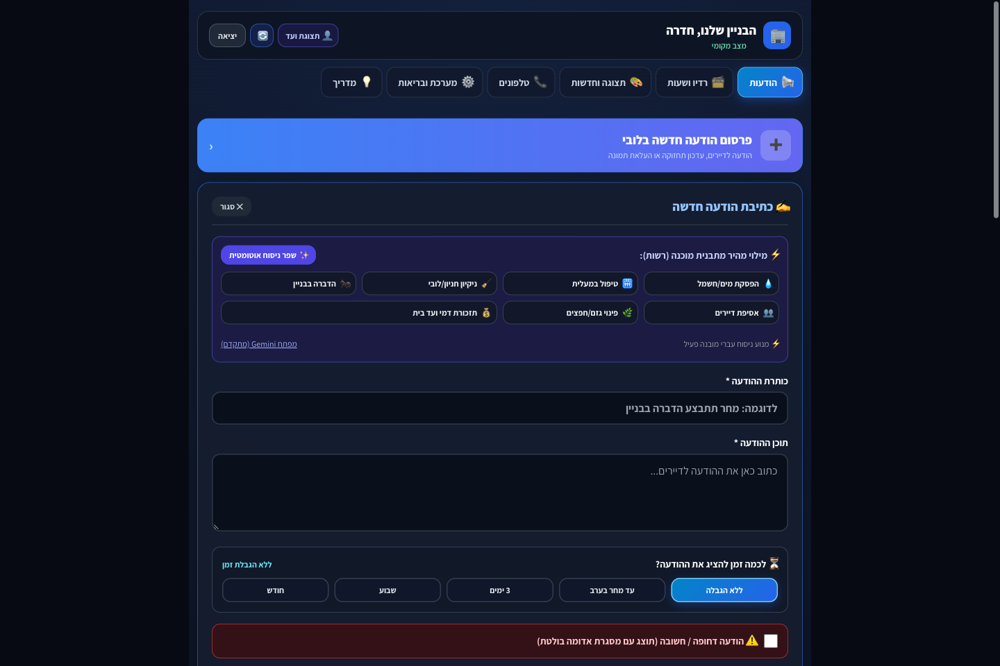
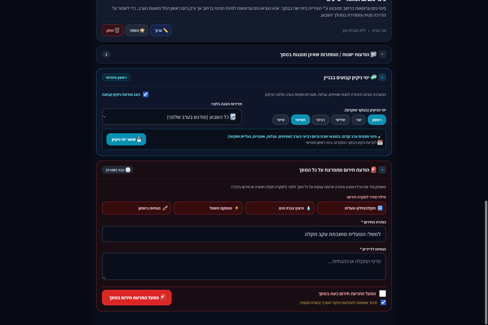
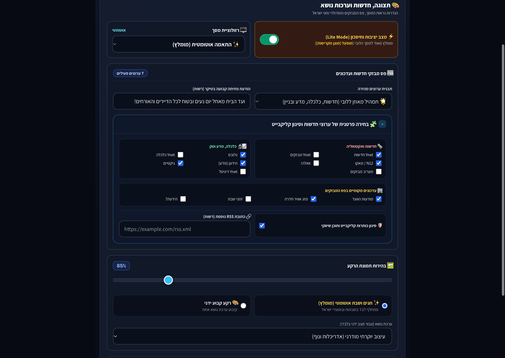
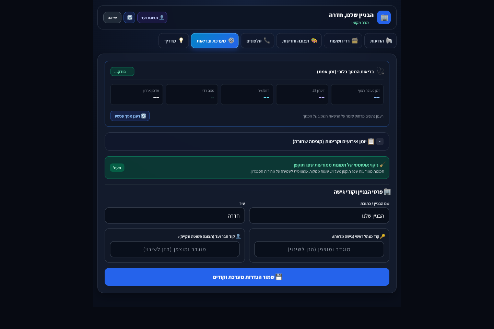
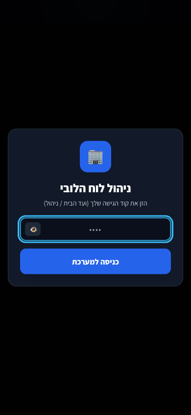
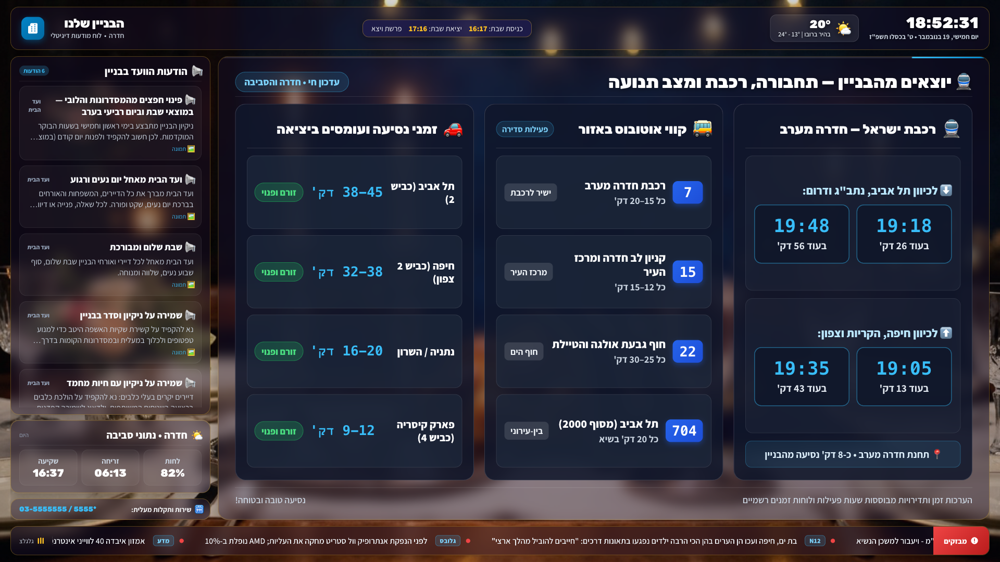
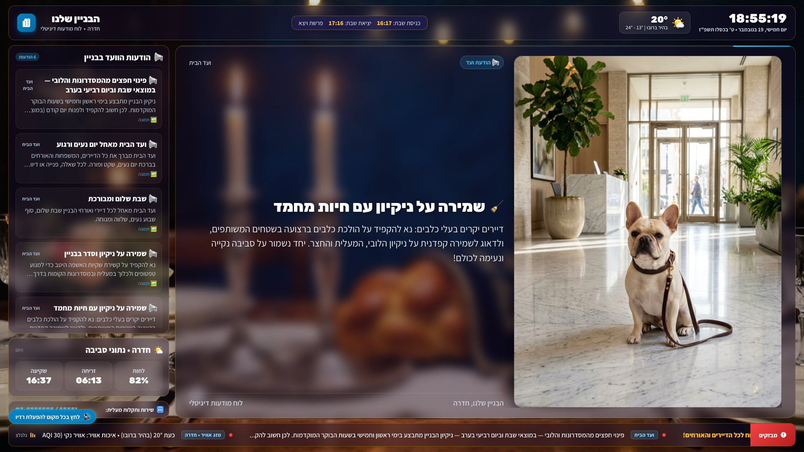
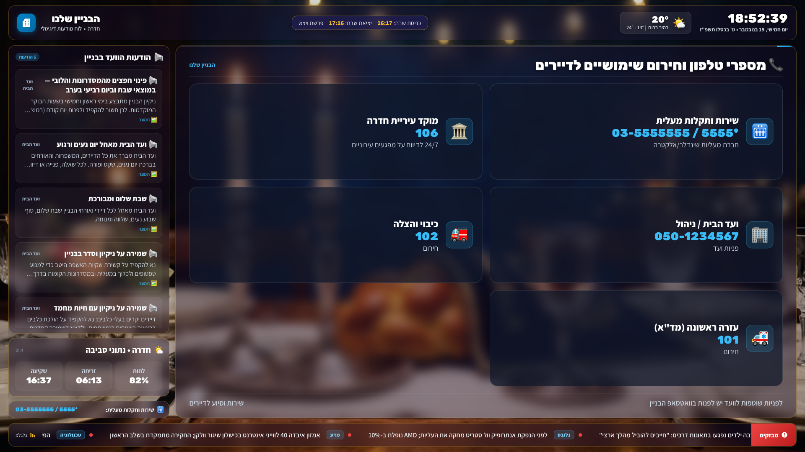
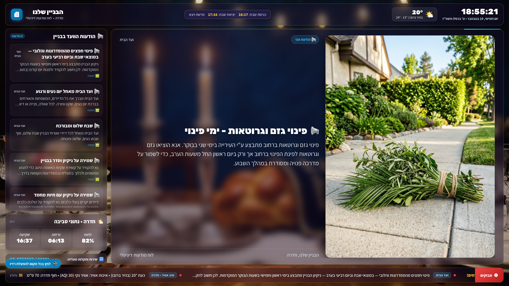
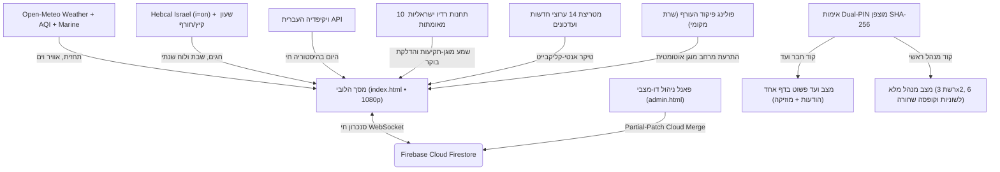

# 🏢 שילוט דיגיטלי חכם לבניין (Smart Building Digital Signage) — גרסה 2.7.0
> מערכת שילוט דיגיטלי עצמאית, אינטראקטיבית ומודרנית למסכי מגע בלובי הבניין (`1920×1080`) ופאנל ניהול דו-מצבי חכם (מצב חבר ועד מופשט ומצב מנהל מלא) לאייפון, אנדרואיד ודסקטופ.

  <b><a href="README.md">🇬🇧 English</a></b> | 
  <b><a href="README.he.md">🇮🇱 עברית (Hebrew)</a></b> | 
  <b><a href="CHANGELOG.md">📋 יומן שינויים מלא (Changelog)</a></b>

---

## 🌐 פריסה וגישה למערכת
* 🖥️ **תצוגת לוח השילוט בלובי:** `https://<your-domain>/` (או כתובת ה-GitHub Pages הראשית)
* 📱 **ממשק ניהול דו-מצבי לוועד ולמנהל (אייפון, אנדרואיד ודסקטופ):** `https://<your-domain>/admin.html`
  * 👤 **קוד חבר ועד (תצוגה פשוטה בדף אחד — ברירת מחדל בתבנית):** `1111` *(מוצפן אוטומטית ב-`SHA-256` בעת הגדרה אישית)*
  * 🔑 **קוד מנהל ראשי (גישה מלאה לכל 6 הלשוניות — ברירת מחדל בתבנית):** `1234` *(מוצפן אוטומטית ב-`SHA-256` בעת הגדרה אישית)*

---

## 🔄 מה היה קודם מול מה יש עכשיו (Before vs. After — אבולוציית המערכת ל-v2.7.0)

| תחום / תת-מערכת | ⬅️ מה היה קודם (גרסאות 1.0–2.3) | ➡️ מה יש עכשיו (גרסה 2.7.0) |
| :--- | :--- | :--- |
| **📱 פאנל ניהול דו-מצבי: "מצב ועד פשוט" מול "מצב מנהל מלא"** | ממשק ארוך ועמוס שדרש גלילה מרובה ולשוניות אופקיות נחתכות בנייד; חברי ועד מבוגרים התקשו להתמצא. | **שני מצבי ממשק ייעודיים באותה מערכת:** 1) **מצב חבר ועד פשוט (`simple-committee-mode`):** הכל מול העיניים במסך אחד באייפון — כפתור ענק **`➕ פרסום הודעה חדשה`**, **כרטיס מוזיקה ו-4 כפתורי ווליום מיידיים בדף הבית**, רשימת הודעות פעילות בלבד ומגירות מתקפלות לימי ניקיון וחירום. 2) **מצב מנהל מלא:** **רשת לשוניות `3×2` גלויה בנייד**, מתג `👤 תצוגת ועד` לבדיקה חיה, כל 6 הלשוניות, **הצפנת `SHA-256`** וסנכרון ענן חלקי (`Partial-Patch Merge`) המונע דריסת הגדרות בין מכשירים. |
| **📢 ניהול מודעות, ימי ניקיון קבועים והגנת נפח** | פרסום ידני מיידי בלבד ותאריך תפוגה בסיסי; הצטברות תמונות Base64 ב-Firestore. | **כפתורי משך פרסום בלחיצה אחת (`ללא הגבלה` / `עד מחר בערב` / `3 ימים` / `שבוע` / `חודש`)**, תזמון מראש (`startsAt`), מחזוריות שבועית (`recurringDays`), **בונה ימי ניקיון קבועים (`#cleaning-schedule-panel`)** המדגיש אוטומטית פינוי שטיחים/עגלות/אופניים/נעליים/שקיות **בערב שלפני הניקיון**, הפרדה בין הודעות פעילות ל-**מגירת ארכיון**, וניקוי תמונות אוטומטי (`Auto-Prune`). |
| **✨ עוזר ניסוח אוטומטי ומאגר 14 תמונות מגוון** | הקלדה ידנית מאפס ומאגר מצומצם של 6 תמונות שחזרו על עצמן. | **עוזר ניסוח חכם לוועד (`✨ שפר ניסוח אוטומטית`)** ל-11 נושאים + 7 תבניות מילוי מהיר + תמיכה ב-Gemini API + כיווץ Canvas (`720px`) + **מאגר 14 תמונות אנכיות (`3:4`) קלות משקל** (4 גזעי כלבים, 4 בניינים ולוביים, מעלית וחניון) עם גיוון דינמי (`resolveNoticeImageUrl`). |
| **🌤️ מזג אוויר, איכות אוויר וים (בקנה מידה מלא ל-1080p)** | תחזית טמפרטורה קטנה עם שטח מת רב במסכי Full HD. | **תחנת סביבה, אוויר וים הפרוסה על מלוא גובה הבמה ב-`1920×1080`:** תחזית 4 ימים מוגדלת + רשת `2×2` מרווחת של איכות אוויר (`AQI`), קרינת `UV`, גובה גלים וטמפ' מים בחוף, כל 28 קודי ה-WMO ו-**המלצה יומית דינמית לפי מצב אמת ויום בשבוע**. |
| **🚆 שקופית "יוצאים מהבניין" (תחבורה ודרכים ב-1080p)** | לא קיים. | **שקופית תחבורה ציבורית ודרכים מוגדלת ל-`1920×1080` (`transit_commute`):** זמני רכבת ישראל הקרובים (מותאמים אוטומטית ל-**ימי חול, שישי, שבת, ערב חג וחג/שבתון**), קווי אוטובוס ללא קטיעת טקסט, וזמני נסיעה בכבישים ראשיים לפי שעות השיא. |
| **🧠 "רגע של עניין במעלית" + ויקיפדיה העברית חיה** | מצגת כללה רק מודעות ועד, מזג אוויר ושבת. | **מנוע תוכן חי ומתחלף ב-1080p (`daily_interest`):** **50+ ערכות מדע, חלל וטבע מקומי** בשילוב שליפה יומית חיה של **"היום בהיסטוריה" מוויקיפדיה העברית (`תבנית:היום בהיסטוריה`)**, **14 מאגרים ייעודיים לחגי ישראל ושבת**, ומצב מורשת והנצחה מכובד בימי הזיכרון. |
| **🕯️ לוח שנה עברי, ישראלי ובינלאומי שנתי מלא** | זמני סוף שבוע בלבד ותאריך לועזי בלבד. | **לוח ישראלי שנתי מתגלגל ל-10 ימים קדימה (`hebcal?v=1&i=on`) + שעון קיץ/חורף אוטומטי:** כל חגי ישראל באמצע ובסוף השבוע, צומות, ראשי חודשים, ספירת העומר, חג הסיגד, יום השפה העברית, יום המשפחה, המימונה, מעבר אוטומטי מערב יום הזיכרון ליום העצמאות, **זיהוי שעון קיץ/חורף (`Asia/Jerusalem`)** ו-30+ ימים מיוחדים. |
| **📰 פס מבזקים מודולרי (14 ערוצים) ואנטי-קליקבייט** | פיד RSS בודד בלבד. | **בונה ערוצים מודולרי (`#modular-news-matrix`):** בחירה פרטנית מתוך **14 ערוצים חיים** — חדשות (`Ynet`, `N12` ישיר ב-CORS XML, `וואלה`, `מעריב`), כלכלה (`גלובס`, `Ynet כלכלה`), מדע וטק (`הידען`, `גיקטיים`, `דיגיטל`) וערוצי בניין/מזג אוויר/שבת/טריוויה, עם תגיות מקור צבעוניות וסינון קליקבייט. |
| **📻 הדלקת רדיו אוטומטית בבוקר ויציבות `rk3368` 24/7** | רענון דף לילי איפס את הרשאת השמע וחסם את הרדיו בבוקר; דליפות זיכרון בחומרה ישנה. | **שמירת הרשאת שמע בלילה (`performNightSoftMaintenanceSweep`):** ניקוי זיכרון פנימי ללא רענון דף מלא כך שהרדיו נדלק אוטומטית כל בוקר ללא צורך בנגיעה במסך; 10 תחנות שידור מאומתות (`200 OK`); הגבלת רוחב טקסטורת GPU בטיקר (`<8192px`), שחרור מפענח השמע בלילה (`preload="none"`), וקופסה שחורה בענן (`device_logs` + `device_health`). |

---

## 📸 גלריית צילומי מסך חיה מהמערכת (מעודכן לגרסה `2.7.0`)

### 📱 1. פאנל הניהול החדש: "מצב ועד פשוט" מול "מצב מנהל מלא" (אייפון ודסקטופ)

| 👤 מצב חבר ועד פשוט באייפון (`simple-committee-mode`) — הכל בדף אחד נקי ללא עומס: פרסום הודעה, מוזיקה ב-4 כפתורי ווליום מיידיים והודעות פעילות | 🔑 מצב מנהל ראשי מלא באייפון — מתג מעבר חי `👤 תצוגת ועד` ורשת לשוניות `3×2` גלויה במלואה ללא גלילה אופקית |
| :---: | :---: |
|  |  |

| ✍️ עורך מודעות חכם: 7 תבניות מוכנות, `✨ שפר ניסוח אוטומטית` וכפתורי משך פרסום בלחיצה אחת (`ללא הגבלה` / `עד מחר` / `3 ימים` / `שבוע` / `חודש`) | 🧼 בונה ימי ניקיון קבועים (המתריע אוטומטית בערב שלפני), מגירת ארכיון הודעות ישנות ופאנל חירום מתקפל |
| :---: | :---: |
|  |  |

| 🧩 לשונית 2 (תצוגה וחדשות): `Lite Mode`, בורר רזולוציה ובונה 14 ערוצי חדשות ועדכונים מודולרי (`#modular-news-matrix`) | 🛡️ לשונית 5 (מערכת ואבטחה): מוניטור בריאות המסך (`device_health`), קופסה שחורה (`device_logs`) וקודי גישה מוצפנים ב-`SHA-256` |
| :---: | :---: |
|  |  |

| 🖼️ גלריית 14 תמונות נושא מועשרת (4 גזעי כלבים, 4 בניינים ולוביים, מעלית חדישה וחניון) | 🔐 מסך כניסה מאובטח בנייד (כולל כפתור הצגה/הסתרה של ה-PIN ואימות `SHA-256`) |
| :---: | :---: |
|  |  |

| 📻 לשונית רדיו ושעות פעילות בנייד (10 תחנות מאומתות ותזמון יומי) | 💡 לשונית מדריך מחוות מגע למסך הלובי הפיזי בנייד |
| :---: | :---: |
|  |  |

---

### 🖥️ 2. מסך השילוט בלובי ב-`1920×1080` Full HD — שקופיות מוגדלות, לוח שנה וויקיפדיה חיה

| 🌤️ תחזית 4 ימים מוגדלת ל-`1080p` + רשת `2×2` מרווחת של איכות אוויר (`AQI`), קרינת `UV`, מצב הים והמלצת היום + תאריך עברי חי וטיקר מתויג | 🚆 שקופית "יוצאים מהבניין" מוגדלת ל-`1080p` — רכבת ישראל (מותאמת לשבת/ערב חג/חג), קווי אוטובוס וזמני נסיעה בכבישים |
| :---: | :---: |
|  |  |

| 🧠 שקופית "רגע של עניין במעלית" ב-`1080p` — מותאמת אוטומטית לשבת/חגים/ימי זיכרון ומשולבת "היום בהיסטוריה" חי מוויקיפדיה העברית | 🧹 מודעת ימי ניקיון קבועים ברוטציה — תזכורת פינוי שטיחים, עגלות, אופניים, נעליים ושקיות בערב שלפני הניקיון |
| :---: | :---: |
|  |  |

| 🕯️ חלון לוח שנה עברי ומועדי ישראל אינטראקטיבי במגע על הכותרת | 🚨 מצב התרעת חירום / פיקוד העורף על כל המסך (הנחיות מרחב מוגן והשתקת רדיו אוטומטית) |
| :---: | :---: |
|  |  |

| 🐶 גיוון דינמי של תמונות כלבים בהודעות (בולדוג צרפתי בלובי / פודל / בורדר קולי / גולדן רטריבר) | 🏢 גיוון דינמי של תמונות בניינים ולוביים (חזית בניין מודרני / לובי בוטיק / חצר מוארת בערב) |
| :---: | :---: |
|  |  |

| 🕯️ כרטיס Grand Hero חגיגי: שבת שלום ופרשת השבוע | 📞 ספר טלפונים שימושי ומוקד מעלית במסך הלובי |
| :---: | :---: |
|  |  |

| 🐕 הודעת שמירה על ניקיון עם חיות מחמד (ללא קטיעת טקסט ב-`46fr/54fr`) | 🌿 הודעת ימי פינוי גזם וגרוטאות |
| :---: | :---: |
|  |  |

---

## ✨ פירוט מלא של יכולות המערכת (גרסה `2.7.0`)

### 📱 1. פאנל ניהול דו-מצבי: "מצב חבר ועד פשוט" מול "מצב מנהל מלא"
* **מצב חבר ועד פשוט (`simple-committee-mode` — מותאם לאייפון ולמשתמשים לא-טכניים):**
  * פותח דף בית אחיד, נקי וברור ללא סרגלי לשוניות מבלבלים (קיצור של `55%` בגובה הגלילה בנייד).
  * **במסך הראשון ללא גלילה:** כפתור ראשי גדול **`➕ פרסום הודעה חדשה בלובי`**, ומתחתיו **`📻 מוזיקה ורדיו בלובי`** עם מתג הפעלה/כיבוי, **4 כפתורי עוצמת שמע בשמירה מיידית (`🔇 השתק` / `🔉 חלש` / `🔊 רגיל` / `📢 חזק`)** ובורר תחנות מהיר.
  * **הפרדה נקייה בין פעיל לארכיון:** רק הודעות שמוצגות כרגע בלובי מופיעות ברשימה הראשית; הודעות שפג תוקפן או הוסתרו נאספות אוטומטית למגירת **`📁 הודעות ישנות / מוסתרות`** עם כפתור ניקוי בלחיצה אחת (`🧹 מחק הודעות שפג תוקפן`).
  * **מגירות מתקפלות בתחתית:** הגדרת **`🧼 ימי ניקיון קבועים`** ופאנל **`🚨 הודעת חירום מתפרצת`** (הנשאר סגור בשגרה וקופץ אוטומטית לראש המסך `order: -10` ברגע שהוא מופעל).
* **מצב מנהל ראשי מלא (`Master Admin`):**
  * **רשת לשוניות `3×2` בנייד:** כל 6 הלשוניות גלויות יחד במסך האייפון ללא גלילה אופקית, עם תמיכה מלאה ב-Safe Area, מטרות מגע של `46px` ושדות קלט של `16px` המונעים זום אוטומטי ב-iOS Safari.
  * **מתג `👤 תצוגת ועד` בכותרת:** מאפשר למנהל הראשי לעבור בלחיצה אחת לתצוגת חבר הוועד הפשוטה ובחזרה.
  * **סנכרון ענן חלקי מונע-דריסות (`Partial-Patch Cloud Merge`):** שמירת ווליום, תחנה או תצוגה שולחת ל-Firestore אך ורק את השדה שהשתנה (`{ merge: true }`), בתוספת שליפה חיה לפני עריכת הודעות (`getFreshNoticesForMutation`), כך ששני חברי ועד לעולם לא דורסים זה את זה.

### 📢 2. לוח מודעות חכם, ימי ניקיון קבועים ועוזר ניסוח אוטומטי
* **מודעת ימי ניקיון קבועים והתרעת פינוי חפצים ערב קודם (`notice-cleaning-schedule`):** פאנל בחירה בלחיצה אחת לימי הניקיון בשבוע (למשל ראשון וחמישי `[0, 4]`), המחשב ומנסח אוטומטית תזכורת לפינוי **יום קודם בערב** (למשל במוצאי שבת וביום רביעי בערב) של כל החפצים מהמסדרונות והלובי — שטיחים, עגלות, אופניים, נעליים ושקיות — ומבליט את המודעה במסך הלובי בערבי ההכנה.
* **בחירת משך פרסום בלחיצה אחת ותזמון מתקדם:** כפתורים מוכנים (`ללא הגבלה`, `עד מחר בערב`, `3 ימים`, `שבוע`, `חודש`), תזמון עתידי (`startsAt`) ומחזוריות שבועית (`recurringDays`).
* **עוזר ניסוח חכם לוועד (`✨ שפר ניסוח אוטומטית`) + 7 תבניות מהירות:** מנוע ניסוח עברי מובנה (ללא צורך במפתח API) ל-11 נושאי ועד בית, שיוך תמונה אוטומטי, תמיכה אופציונלית ב-Gemini API, דחיסת תמונות Canvas (`720px`) וניקוי תמונות אוטומטי ממודעות ישנות (`Auto-Prune`).
* **מאגר 14 תמונות נושא אנכיות (`3:4`) עם גיוון דינמי (`resolveNoticeImageUrl`):** 4 גזעי כלבים, 4 בניינים ולוביים, מעלית חדישה וחניון תת-קרקעי במשקל קל (`100KB–250KB`), המתחלפים דינמית ללא הכבדת זיכרון.

### 🕯️ 3. לוח שנה ישראלי שנתי מלא, שעון קיץ/חורף ו"היום בהיסטוריה" מוויקיפדיה
* **לוח ישראלי מתגלגל ל-10 ימים קדימה (`hebcal?v=1&i=on`):** מכסה את כל חגי ישראל באמצע ובסוף השבוע, צומות, ראשי חודשים, ספירת העומר (כולל הפרדה מדויקת של ל"ג בעומר), חג הסיגד, יום השפה העברית, יום המשפחה, חג המימונה, מעבר ערב יום הזיכרון ליום העצמאות, ותצוגת אירועי ה-7 ימים הקרובים בחלונית המגע.
* **זיהוי אוטומטי של מעבר לשעון קיץ / שעון חורף (`detectIsraelDstTransition`):** מזהה שינויי היסט ב-`Asia/Jerusalem` ומתריע לדיירים מראש, לצד 30+ ימים מיוחדים לאומיים ובינלאומיים, ציוני דרך בשנת הלימודים ועונות השנה.
* **שליפה יומית חיה מוויקיפדיה העברית (`תבנית:היום בהיסטוריה`):** מושכת מדי יממה אירועים היסטוריים מאומתים לתאריך הנוכחי (נשמר במטמון ל-24 שעות עם סינון מותאם לכל המשפחה), לצד 14 מאגרי תוכן ייעודיים לחגים, שבת וימי זיכרון ממלכתיים.

### 🌤️ 4. שקופיות מידע בקנה מידה מלא ל-`1920×1080` (מזג אוויר וים, תחבורה וטריוויה)
* **מזג אוויר, איכות אוויר וים (`weather_forecast`):** כל 28 קודי מזג האוויר של WMO, תחזית 4 ימים מוגדלת ורשת `2×2` מרווחת של מדד `AQI`, קרינת `UV`, גובה גלים וטמפ' מים בחוף, והמלצה יומית חכמה המותאמת לתנאי החוץ וליום בשבוע (כולל אזהרת אספלט חם לבעלי כלבים בקיץ).
* **תחבורה, רכבת ודרכים (`transit_commute`):** זמני רכבת ישראל הקרובים לשני הכיוונים עם התאמה לימי חול, שישי, שבת, ערב חג וחג/שבתון, קווי אוטובוס מקומיים וזמני נסיעה בכבישים הראשיים.
* **רגע של עניין במעלית (`daily_interest`):** טיפוגרפיה מוגדלת לקריאה ממרחק 3–5 מטרים (`~31px–35px` ב-1080p) עם רוטציה רציפה של עשרות אלפי שילובי מדע, היסטוריה וטריוויה.

### 📰 5. בונה ערוצי חדשות ועדכונים מודולרי (14 ערוצים) ואנטי-קליקבייט
* **מטריצת ערוצים מודולרית (`#modular-news-matrix`):** בחירה מתוך תבניות מוכנות (`smart_mix`, `מדע וטק`, `כלכלה`, `הודעות הבניין בלבד`) או סימון פרטני של **14 ערוצים**: חדשות (`Ynet`, `Ynet מבזקים`, `N12 / מאקו` בחיבור XML ישיר ומהיר, `וואלה!`, `מעריב`), כלכלה (`גלובס`, `Ynet כלכלה`), מדע וטכנולוגיה (`הידען`, `גיקטיים`, `Ynet דיגיטל`), וערוצים מקומיים (`מודעות הוועד`, `מזג אוויר`, `זמני שבת ולוח עברי`, `הידעת?`), כולל תגיות מקור וסינון קליקבייט.

### 📻 6. רדיו ישראלי מאומת והדלקה אוטומטית בבוקר ללא נגיעה במסך
* **10 תחנות שידור חיות ומאומתות (`200 OK`):** `גלגלצ`, `103FM`, `גלי צה"ל`, `כאן 88`, `כאן גימל`, `קול המוסיקה`, `Eco 99 FM`, `רדיוס 100FM`, `Chillout Lounge` ו-`Dance & Hits` (כולל שדרוג אוטומטי בזמן ריצה של כתובות ישנות במטמון).
* **פתרון מלא למדיניות ה-Autoplay בבוקר:** תחזוקת הלילה ב-`23:05` וב-`04:00` מבצעת ניקוי זיכרון פנימי (`performNightSoftMaintenanceSweep`) **ללא** רענון דף מלא (`window.location.reload()`), כך שהרשאת המגע של הדפדפן (`navigator.userActivation.hasBeenActive`) נשמרת לאורך הלילה והרדיו נדלק אוטומטית בבוקר, לצד שחרור מלא של מפענח השמע בלילה (`preload="none"`) וזיהוי תקיעות סטרים תוך 30 שניות.

### 🔐 7. אבטחת `SHA-256`, בידוד שכפולים (`Fork Isolation`) ושרידות `rk3368` 24/7
* **הצפנת קודי גישה ב-`SHA-256` והקשחת שרת:** קודי ה-PIN מומלחים ומגובבים חד-כיוונית (`adminPinHash` / `editorPinHash`), קודי ברירת המחדל `1234`/`1111` נחסמים אוטומטית ברגע שהוגדר קוד אישי, והשרת המקומי מוגן בכתיבת קבצים אטומית (`.tmp` + `rename`), הגנת SSRF ואימות העלאות.
* **בידוד שכפולים ב-GitHub:** שכפול התבנית לדומיין חדש רץ אוטומטית במצב מקומי מבודד (`data/*.json`) עד להזנת מפתחות ענן משלו ב-`js/config.js` או ב-GitHub Secret (`FIREBASE_CONFIG_JS`).
* **יציבות חומרה מוכחת (`Android 7.1.2 / rk3368`):** מצב `Lite Mode`, הגבלת רוחב טקסטורת טיקר מתחת ל-`8192px` של המעבד הגרפי, מוניטור בריאות חי (`device_health`) וקופסה שחורה (`device_logs`).

---

## 🏗️ ארכיטקטורת המערכת ותזרים הנתונים

---

## 📱 לשוניות ממשק הניהול והרשאות גישה (Dual-PIN `SHA-256`)

| לשונית | תיאור היכולות בלשונית | מנהל ראשי (`1234` בתבנית) | חבר ועד (`1111` בתבנית) |
| :--- | :--- | :---: | :---: |
| 📢 **1. דף הבית: הודעות, מוזיקה מהירה וחירום** | כפתור פרסום הודעה (עם כפתורי משך בלחיצה אחת ועוזר ניסוח), **כרטיס מוזיקה ו-4 כפתורי ווליום מיידיים**, הודעות פעילות מול מגירת ארכיון, ומגירות מתקפלות לימי ניקיון וחירום | ✅ *(+ מתג `👤 תצוגת ועד`)* | ✅ *(מסך בית מאוחד ונקי)* |
| 🎨 **2. תצוגה, שקופיות וחדשות** | מצב `Lite Mode`, בורר רזולוציה (`1080p`/`720p`), מתגי שקופיות, **בונה ערוצי חדשות מודולרי (14 ערוצים)**, שקיפות ופיצוי תאורה | ✅ | ❌ *(מוסתר)* |
| 📞 **3. טלפונים ומעלית** | עריכת מספרי טלפון לתקלות מעלית, מוקד עירוני וועד הבית | ✅ | ❌ *(מוסתר)* |
| 📻 **4. רדיו ושעות פעילות** | קביעת שעות הדלקה וכיבוי אוטומטיים (`06:30–23:00`), כוונון ווליום עדין ונגן בדיקה חי ל-10 תחנות מאומתות | ✅ | ❌ *(שליטה מהירה בדף הבית)* |
| ⚙️ **5. מערכת, בריאות ואבטחה** | פרטי הבניין, מוניטור בריאות המכשיר (`device_health`), קופסה שחורה (`device_logs`), וניהול **קודי גישה מוצפנים ב-`SHA-256`** | ✅ | ❌ *(מוסתר)* |
| 💡 **6. מדריך מגע** | מדריך מחוות מגע במסך הלובי | ✅ | ❌ *(מוסתר)* |

---

## 📦 היסטוריית גרסאות (Release History)

| גרסה | תאריך | עיקרי השינויים והחידושים |
| :--- | :---: | :--- |
| **`v2.7.0`** | `2026-11-19` | **פאנל ניהול דו-מצבי (ועד פשוט + מנהל מלא), לוח שנה ישראלי שנתי מלא, "היום בהיסטוריה" מוויקיפדיה, הקשחת שרת והצפנת `SHA-256`:** עיצוב מחדש של פאנל הניהול לנייד עבור חברי ועד (מסך בית ללא גלילה עם שליטה מהירה במוזיקה ו-4 כפתורי ווליום מיידיים, בחירת משך פרסום בלחיצה אחת, הפרדת הודעות פעילות מארכיון, רשת לשוניות `3×2` וסנכרון ענן חלקי מונע-דריסות); שדרוג ללוח ישראלי מתגלגל מלא (`hebcal?i=on`), שעון קיץ/חורף אוטומטי, 30+ ימים מיוחדים, שליפה יומית מוויקיפדיה העברית ו-14 מאגרי חגים/שבת/ימי זיכרון; שדרוג 10 תחנות הרדיו; הצפנת `SHA-256` לקודי ה-PIN, בידוד שכפולים (`Fork Isolation`) וסוויטת 26 צילומי מסך חיים חדשים. |
| **`v2.6.1–2.6.2`** | `2026-11-05` | **מטריצת 14 ערוצי חדשות, ימי ניקיון קבועים, הגדלת `1080p` ויציבות `rk3368`:** בונה ערוצי חדשות מודולרי (`#modular-news-matrix`), בונה ומודעת ימי ניקיון קבועים המתריעה בערב שלפני, הגדלת פאנלי המידע למלוא גובה `1920×1080`, שמירת הרשאת שמע בלילה להדלקת רדיו בוקר ב-`06:30`, ומניעת דליפות זיכרון טבעיות ב-`rk3368`. |
| **`v2.6.0`** | `2026-10-21` | **נתוני אוויר וים, שקופית תחבורה, תאריך עברי, טריוויה ומאגר 14 תמונות נושא:** חיבור ל-Open-Meteo Air Quality & Marine (`AQI`, `UV`, גלים וטמפ' ים), שקופית `transit_commute`, תאריך עברי בכותרת, פולינג פיקוד העורף והרחבת גלריית המודעות ל-14 תמונות מגוונות. |
| **`v2.5.0`** | `2026-10-18` | **כלי ניהול חכמים באדמין:** תזמון מודעות מראש (`startsAt`) ומחזוריות שבועית (`recurringDays`); **פאנל התרעת חירום מתפרצת** על כל המסך עם 4 תבניות בלחיצה אחת והשתקת רדיו אוטומטית; **עוזר ניסוח מודעות חכם לוועד (`✨ שפר ונסח אוטומטית`)**; וניקוי אוטומטי (`Auto-Prune`) של תמונות ממודעות שפג תוקפן. |
| **`v2.4.6`** | `2026-10-18` | **שרידות רשת 24/7 והגנות יציבות:** התאוששות אוטומטית מנפילות Wi-Fi; מנויים עצלים ל-`device_health` ו-`device_logs`; זיהוי תקיעת באפר ברדיו חי (30 שניות); סגירה אוטומטית של מודאלים לאחר 45 שניות; ומניעת חזרת "מודעות זומבי". |
| **`v2.4.3–2.4.5`** | `2026-10-13` | **קופסה שחורה, בורר רזולוציה ואופטימיזציית GPU:** הוספת Blackbox Flight Recorder (`smart_lobby/device_logs`), בורר רזולוציית מסך (`auto` / `1080p` / `720p`), כיווץ תמונות Canvas (`720px`) והקלות GPU ל-`rk3368`. |
| **`v2.1.0–2.4.2`** | `2026-09-16` | **סנכרון ענן Firebase, הרשאות Dual-PIN, חבילת 15 חגים ו-Lite Mode:** חיבור ל-Google Cloud Firestore בזמן אמת, מוניטור `device_health`, 15 ערכות צילום לחגי ישראל ומצב `Lite Mode`. |

*(לפירוט טכני מלא של כל שינוי וקובץ ראו [`CHANGELOG.md`](CHANGELOG.md)).*

---

## 📺 המלצות לאפליקציות Kiosk ונעילת מסך באנדרואיד

### 🥇 1. [Webview Kiosk](https://webviewkiosk.nktnet.uk) (המלצה ראשית — 100% חינמי וקוד פתוח)
* **100% קוד פתוח וחינמי (FOSS):** ללא הגבלות, ללא סימני מים וללא צורך ברישיונות בתשלום.
* **מותאם במיוחד למכשירים ישנים:** עובד חלק ומהיר על טאבלטים וממירים ישנים (כגון `Android 7.1.2 / rk3368`) עם צריכת זיכרון מינימלית (מומלץ להפעיל **Lite Mode** בהגדרות התצוגה).
* **התקנה פשוטה:** זמין ב-[Google Play](https://play.google.com/store/apps/details?id=uk.nktnet.webviewkiosk), ב-[F-Droid](https://f-droid.org/) ובהורדת APK ישירה מ-[GitHub](https://github.com/nktnet1/webview-kiosk).

### 🥈 2. [Fully Kiosk Browser](https://www.fully-kiosk.com/) (התקן המסחרי המתקדם)
* הפעלה אוטומטית לאחר הפסקת חשמל, נעילת Kiosk מלאה, אישור השמעת שמע אוטומטית (`Autoplay Audio`) וזיהוי תנועה במצלמה.

---

## 🌍 איך להקים מסך כזה לבניין שלכם ב-3 דקות (מדריך שימוש בתבנית)

1. **לחצו על כפתור `Use this template`** בראש המאגר ב-GitHub.
2. **התאימו את פרטי הבניין** בקובץ `data/settings.json` (שם הבניין, עיר וקואורדינטות GPS לזמני שבת ומזג אוויר מדויקים). *(התבנית רצה מיד במצב עצמאי תקין ללא צורך ב-Firebase!).*
3. **הפעילו את GitHub Pages:** היכנסו ל-**Settings ➡️ Pages** במאגר שלכם ובחרו ב-**GitHub Actions** (או `main`).
4. *(אופציונלי — לסנכרון ענן בזמן אמת מהטלפונים של חברי הוועד)* **חיבור Firebase Firestore:**
   * פתחו פרויקט חינמי ב-[Firebase Console](https://console.firebase.google.com), צרו **Firestore Database**, והדביקו את הכללים מתוך [`firestore.rules`](firestore.rules).
   * העתיקו את `js/config.example.js` לקובץ `js/config.js` מקומי (או הגדירו כסוד `FIREBASE_CONFIG_JS` ב-GitHub Actions Secrets) עם מפתחות ה-Web App שלכם.

---

## 📜 רישיון וקרדיט

כל הזכויות שמורות (c) 2026 **עומר ניניו (Omer Ninyo)**.  
פרויקט זה מופץ תחת תנאי רישיון **MIT עם ייחוס חובה (Attribution)**. כולם מוזמנים לעיין, להשתמש, לשכפל ולהתאים את הפרויקט לבניין שלהם, ובלבד שנשמר קרדיט מפורש ליוצר הפרויקט **Omer Ninyo**.
