# 🏢 שילוט דיגיטלי חכם לבניין (Smart Building Digital Signage) — גרסה 2.6.0
> מערכת שילוט דיגיטלי עצמאית, אינטראקטיבית ומודרנית למסכי מגע בלובי הבניין ופאנל ניהול חכם לוועד הבית.

  <b><a href="README.md">🇬🇧 English</a></b> | 
  <b><a href="README.he.md">🇮🇱 עברית (Hebrew)</a></b> | 
  <b><a href="CHANGELOG.md">📋 יומן שינויים מלא (Changelog)</a></b>

---

## 🌐 פריסה וגישה למערכת
* 🖥️ **תצוגת לוח השילוט בלובי:** `https://<your-domain>/` (או כתובת ה-GitHub Pages הראשית)
* 📱 **ממשק ניהול לוועד (נייד ודסקטופ):** `https://<your-domain>/admin.html`
  * 🔑 **קוד מנהל ראשי ברירת מחדל:** `1234` *(ניתן לשינוי בהגדרות)*
  * 👤 **קוד חבר ועד ברירת מחדל:** `1111` *(ניתן לשינוי בהגדרות)*

---

## 🔄 מה היה קודם מול מה יש עכשיו (Before vs. After — אבולוציית המערכת ל-v2.6.0)

טבלה זו מרכזת את קפיצת המדרגה ההנדסית והמוצרית מהגרסאות הראשונות (`v1.0–v2.3`) ועד לגרסה הנוכחית (`v2.6.0`):

| תחום / תת-מערכת | ⬅️ מה היה קודם (גרסאות 1.0–2.3) | ➡️ מה יש עכשיו (גרסה 2.6.0) |
| :--- | :--- | :--- |
| **📢 ניהול ותזמון מודעות ועד** | פרסום ידני מיידי בלבד ותאריך תפוגה בסיסי; סכנת חזרת מודעות שנמחקו ("מודעות זומבי") מקובץ ברירת המחדל; הצטברות תמונות Base64 כבדות ב-Firestore. | **תזמון מראש (`startsAt`) ומחזוריות שבועית (`recurringDays: [0..6]`)** לפי ימים בשבוע (`א'–ש'`); אכיפה בזמן אמת כל 60 שניות; מניעת חזרת מודעות שנמחקו (`smart_lobby_deleted_notices`); **ניקוי אוטומטי (`Auto-Prune`)** של תמונות Base64 ממודעות שפג תוקפן מעל 24 שעות + מד חיסכון נפח באדמין. |
| **✨ כתיבת ועיצוב מודעות (AI / Smart Composer)** | הקלדה ידנית מאפס של כל הודעה ובחירת תמונה ידנית מהטלפון (ללא כיווץ תמונות בצד הלקוח ב-GitHub Pages). | **עוזר ניסוח חכם לוועד (`#ai-polish-notice-btn`)**: מנוע ניסוח עברי מובנה ל-11 נושאים (מים, מעלית, חשמל, ניקיון, הדברה, חניה, גזם, אסיפה, ועד, חגים, שיפוצים) + תמיכה ב-Gemini 1.5 Flash API + **7 תבניות מילוי מהיר בלחיצה (`SMART_DRAFTS`)** + **כיווץ תמונות אוטומטי ב-Canvas (`720px`, איכות `0.78`)**. |
| **🚨 מצב חירום והתרעות פיקוד העורף** | לא היה מצב חירום ייעודי או חיבור להתרעות פיקוד העורף; נדרש לכתוב מודעה רגילה במקרה חירום. | **שכבה כפולה (אוטומטית + ידנית):** 1) **חיבור אוטומטי להתרעות פיקוד העורף (`startOrefAlertPoller`)** המזהה אזעקה פעילה באזור הבניין, מציג הנחיות מרחב מוגן (90 שניות), משתיק מיד את הרדיו וחוזר לשגרה לאחר 10 דקות. 2) **פאנל חירום באדמין** (למנהל ולחבר ועד) עם 4 כפתורי הפעלה בלחיצה אחת (`oref`, `elevator`, `water`, `power`). |
| **🌤️ מזג אוויר, איכות אוויר וים** | תחזית טמפרטורה בסיסית ל-4 ימים בלבד. | **תחנת סביבה, אוויר וים מלאה (Open-Meteo Air Quality & Marine API ללא מפתח):** מדד איכות אוויר (`AQI`) עם סיווג צבעים, מדד קרינת `UV`, גובה גלים וטמפ' מים בחוף הים, ו-**המלצה יומית חכמה לדיירים (`dailyTip`)** (תליית כביסה, סגירת חלונות באובך, שתייה מרובה) בשקופית התחזית ובמודאל. |
| **🚆 שקופית "יוצאים מהבניין" (תחבורה ודרכים)** | לא קיים. | **שקופית תחבורה ציבורית ודרכים (`transit_commute`):** זמני רכבת ישראל הקרובים (לכיוון ת"א/דרום ולכיוון חיפה/צפון בהתאמה לימי חול, שישי, שבת ומוצ"ש), קווי אוטובוס מרכזיים באזור הבניין, וזמני נסיעה משוערים בכבישים ראשיים (כביש 2, כביש 4, כביש 9) עם חיווי עומסי תנועה חי לפי שעות השיא. |
| **🧠 שקופית "רגע של עניין במעלית" (Infotainment)** | מצגת שקופיות כללה רק מודעות ועד, מזג אוויר ושבת. | **שקופית העשרה יומית (`daily_interest` בסגנון Captivate):** 20 ערכות תוכן מתחלפות אוטומטית מדי יום הכוללות: **📅 היום בהיסטוריה / הידעת?**, **🧠 חידת טריוויה יומית לדיירים (עם תשובה)**, ו-**💡 טיפ יומי לבית ולקהילה**. |
| **🕯️ לוח עברי חי ומועדי ישראל** | הצגת פרשת השבוע וזמני הדלקת נרות בלבד; תאריך לועזי בלבד מתחת לשעון; בחירת `holidays[0]` שלעיתים הסתירה חג מרכזי. | **לוח עברי חי בכותרת:** תאריך עברי מלא באותיות עבריות מתחת לשעון (`יום רביעי, 21 באוקטובר • י' בחשוון תשפ"ז`), תעדוף חגים מרכזיים על פני אירועים משניים, ותגיות אוטומטיות בכותרת ובמודאל עבור **🕯️ נרות חנוכה, 🌾 ספירת העומר ו-🌙 ראש חודש**. |
| **📰 מבזקי חדשות ומנוע אנטי-קליקבייט** | משיכת פיד RSS בודד כל 5 דקות דרך `rss2json` בלבד (חשוף לחסימות מכסה 429 ולכותרות צהובות/ממומנות). | **מנוע חדשות משולב ללא קליקבייט (`smart_mix`):** סינון אוטומטי של כותרות צהובות ותוכן שיווקי (`filterClickbaitAndFormatHeadline`), שילוב ערוצי מדע, טכנולוגיה וכלכלה (`גלובס`, `כלכליסט`, `הידען`, `גיקטיים`, `כאן`) עם תגיות נושא (`[מדע]`, `[כלכלה]`, `[טכנולוגיה]`), רענון כל 10 דקות (חיסכון 50% במכסה) וגיבוי אוטומטי ב-`AllOrigins` XML `DOMParser`. |
| **🛡️ יציבות Kiosk 24/7, אודיו וקופסה שחורה** | רגישות לניתוקי Wi-Fi באתחול, תקיעות באפר ברדיו חי, עומס GPU על מעבדי אנדרואיד ישנים (`rk3368`), וחוסר חיווי על קריסות מרחוק. | **הנדסת שרידות 24/7:** התאוששות אוטומטית מניתוקי Wi-Fi (`online` listener + טעינת SDK דינמית), זיהוי תקיעת באפר ברדיו חי (30 שניות) וריענון אוטומטי (`recycleAudioBuffer`), אופטימיזציית **Lite Mode** ובורר רזולוציה (`auto`/`1080p`/`720p`), סגירת מודאלים אוטומטית (45 שניות), ו-**קופסה שחורה בענן (`device_logs` + `device_health`)** עם מגבלת קצב (Circuit Breaker) ומנויים עצלים (Lazy Listeners). |

---

## 📸 גלריית צילומי מסך מהמערכת

### 🖥️ 1. מסך שילוט הלובי הראשי (תצוגת Kiosk ב-1080p Full HD)

| 🐕 הודעת ועד: שמירה על ניקיון וחיות מחמד | 🌿 הודעת ועד: ימי פינוי גזם וגרוטאות |
| :---: | :---: |
| 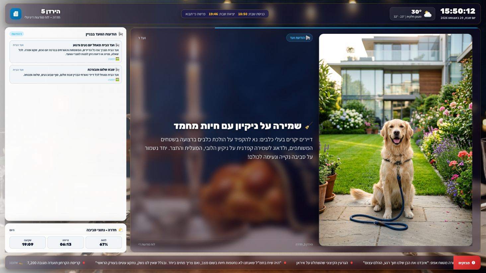 | 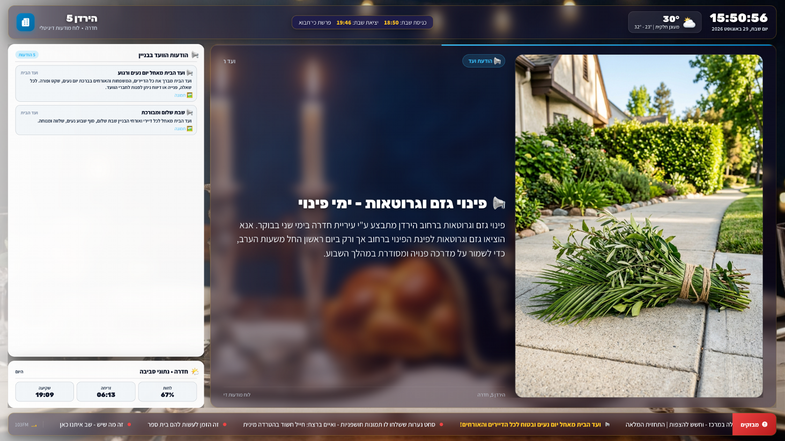 |

| 🧹 הודעת ועד: ניקיון מסדרונות ומעלית | ✨ הודעת ועד: ברכת יום רגוע בלובי |
| :---: | :---: |
| 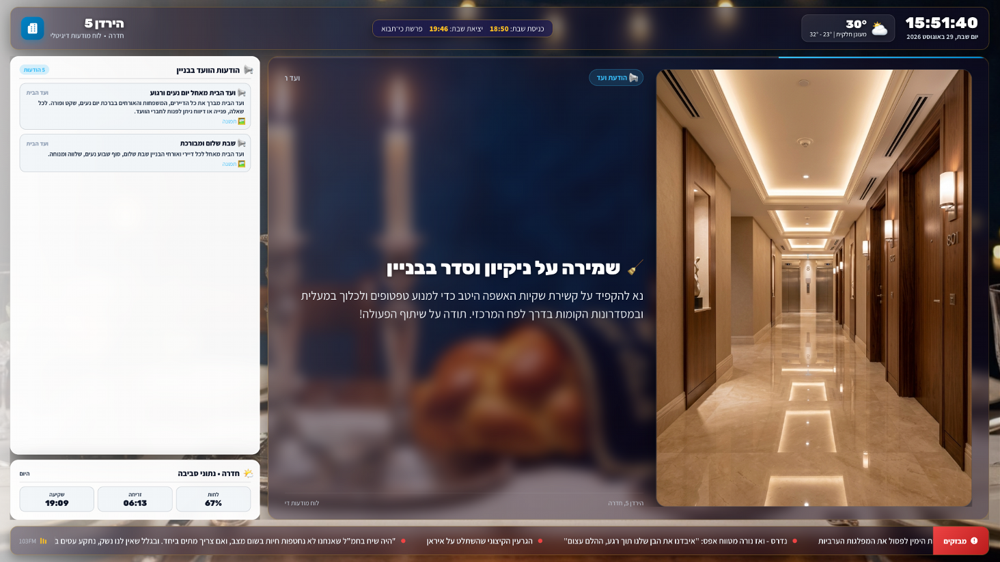 | 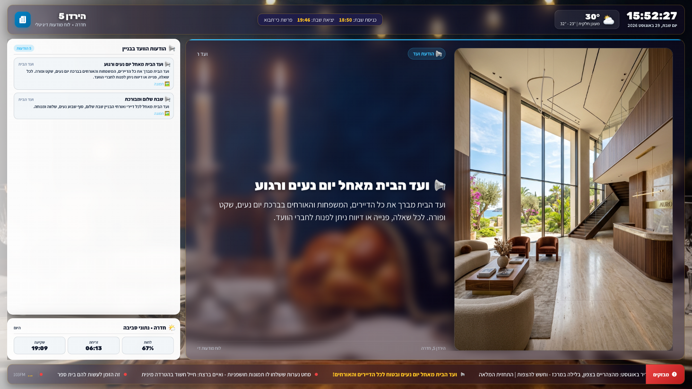 |

| 🕯️ כרטיס Grand Hero: שבת שלום והדלקת נרות | 📞 ספר טלפונים ומספרי חירום לבניין |
| :---: | :---: |
| 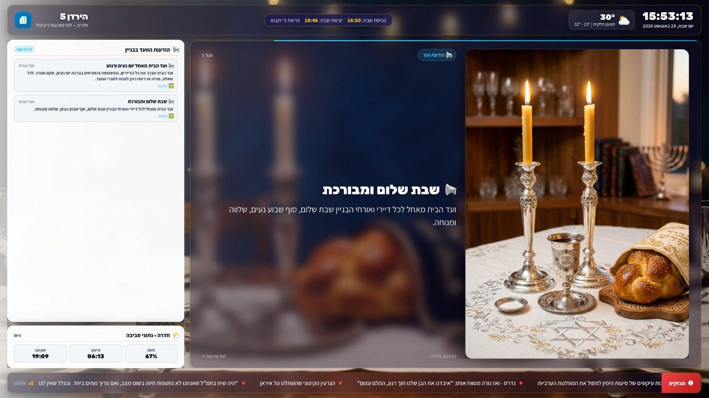 | 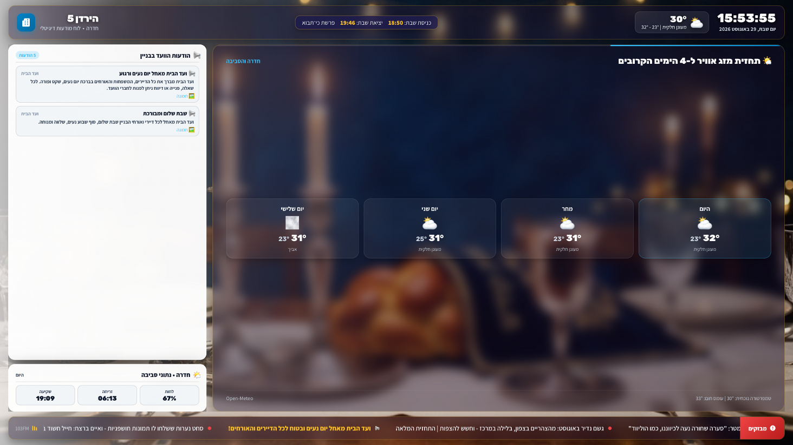 |

---

### 📱 2. פאנל ניהול לוועד הבית (Mobile & Tablet Admin)

| 🔐 1. מסך הזנת קוד PIN מאובטח | 📢 2. לשונית ניהול הודעות ומודעות |
| :---: | :---: |
| 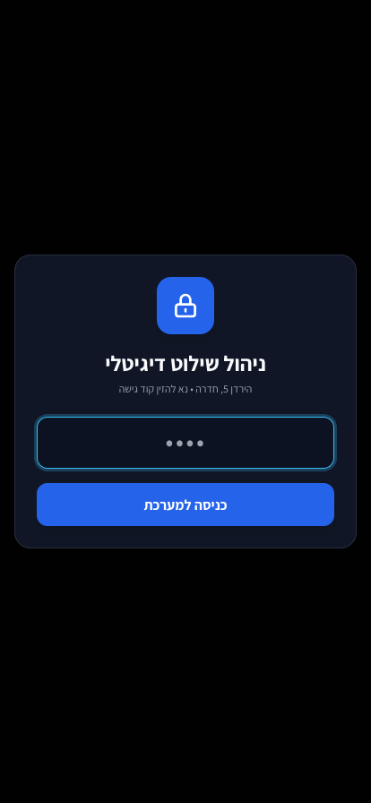 | 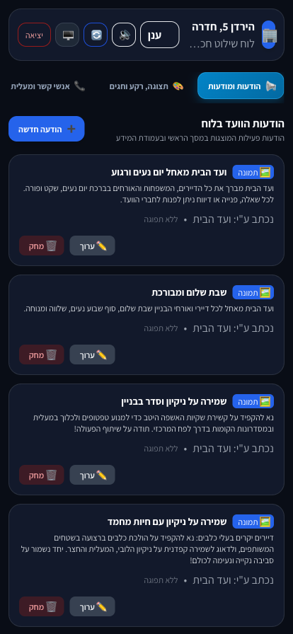 |

| 🎨 3. כיול תצוגה, שקיפות וערכות נושא | 📻 4. נגן מוזיקת רקע ורדיו 103FM |
| :---: | :---: |
| 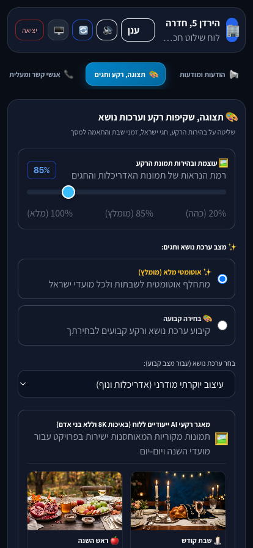 | 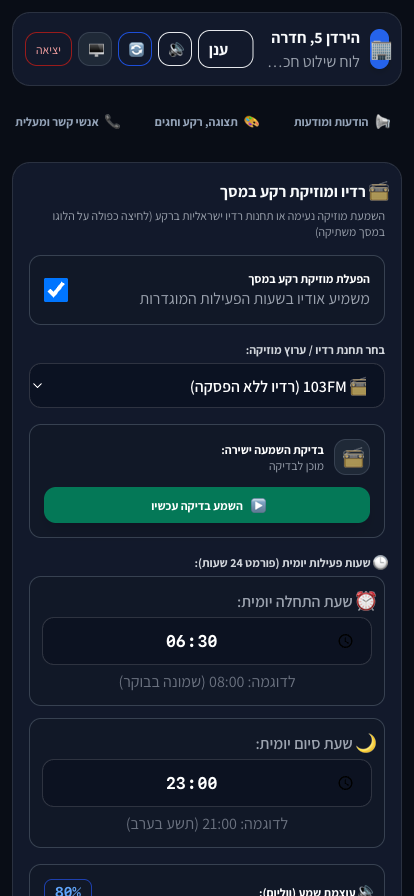 |

| 💡 5. מפת מחוות מגע למסך הפיזי | 🖼️ 6. חלון גלריית תמונות מובנית |
| :---: | :---: |
|  | 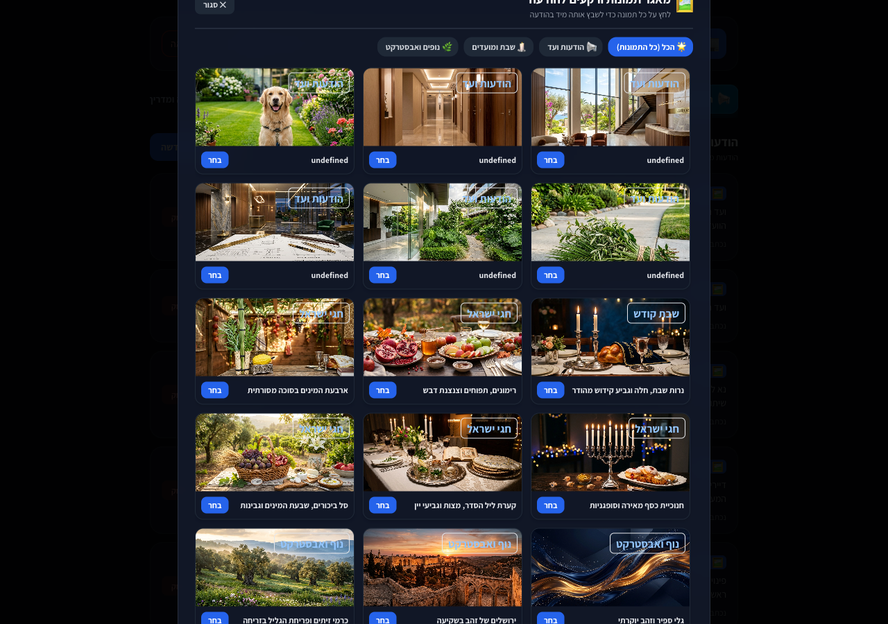 |

---

## ✨ פירוט יכולות המערכת (גרסה 2.6.0)

### 📢 1. לוח הודעות חכם, תזמון מראש ועוזר ניסוח אוטומטי
* **תזמון מראש ומחזוריות שבועית:** הגדרת תאריך ושעת התחלת פרסום (`startsAt`), תאריך ושעת תפוגה (`expiresAt`), ובחירת ימים קבועים בשבוע (`recurringDays: א'–ש'`) עבור הודעות חוזרות (כגון ימי ניקיון או הוצאת גזם).
* **עוזר ניסוח חכם לוועד (`✨ שפר ונסח אוטומטית`):** הופך טיוטה קצרה או מילות מפתח לנוסח רשמי, מנומס ורהוט בעברית עבור 11 נושאים נפוצים בבניין, מצרף תמונת נושא אוטומטית, מסמן דחיפות בעת תקלה ומחשב תאריך תפוגה מומלץ. תומך גם בחיבור אופציונלי ל-Google Gemini 1.5 Flash API.
* **7 תבניות מילוי מהיר בלחיצה אחת (`SMART_DRAFTS`):** הפסקת מים, תחזוקת מעלית, ניקיון חניון/לובי, הדברה, אסיפת דיירים, פינוי גזם וגביית דמי ועד.
* **כיווץ תמונות חכם וניקוי אוטומטי (`Auto-Prune`):** העלאת תמונות מהנייד עוברת דחיסת Canvas אוטומטית (`720px`), ותמונות של מודעות שפג תוקפן מעל 24 שעות מנוקות אוטומטית כדי לשמור על מסד הנתונים מהיר ומתחת למגבלת ה-1MB של Firestore.

### 🚨 2. מצב התרעת חירום וחיבור אוטומטי לפיקוד העורף
* **חיבור אוטומטי להתרעות פיקוד העורף (`startOrefAlertPoller`):** דגימה שקטה ברקע המזהה אזעקת אמת באזור הבניין, מעבירה מיד את המסך לתצוגת חירום אדומה עם הנחיות כניסה למרחב המוגן, משתיקה את הרדיו החי, ומחזירה את המסך לשגרה אוטומטית 10 דקות לאחר תום האזעקה.
* **פאנל חירום ידני מהנייד:** זמין בראש לשונית 1 באדמין (גם למנהל ראשי וגם לחבר ועד) עם 4 תבניות חירום בלחיצה אחת: **🚀 הנחיות פיקוד העורף**, **🛗 השבתת מעלית / חילוץ**, **💧 הפסקת מים דחופה**, ו-**⚡ תקלת חשמל בבניין**.

### 🌤️ 3. שקופיות תוכן חכמות ללובי (Weather, Transit & Infotainment)
* **סביבה, אוויר וים בשקופית מזג האוויר:** בנוסף לתחזית 4 ימים, מוצגים מדד איכות האוויר (`AQI`), קרינת `UV`, מצב הים (גובה גלים וטמפ' המים בחוף), והמלצה יומית חכמה לדיירים.
* **שקופית "יוצאים מהבניין — תחבורה, רכבת ודרכים" (`transit_commute`):** זמני רכבת ישראל הקרובים לשני הכיוונים (כולל התאמה לימי שישי, שבת ומוצ"ש), קווי אוטובוס מרכזיים בשכונה, וזמני נסיעה משוערים לצירי תנועה מרכזיים עם חיווי עומס לפי שעות השיא.
* **שקופית "רגע של עניין במעלית" (`daily_interest`):** תוכן מתחלף יומי הכולל עובדה היסטורית/מדעית ("היום בהיסטוריה / הידעת?"), חידת טריוויה יומית עם תשובה, וטיפ שימושי לבית ולקהילה.

### 🕯️ 4. לוח שנה עברי חי ומועדי ישראל
* **תאריך עברי מלא בכותרת:** הצגת התאריך העברי המדויק באותיות עבריות לצד התאריך הלועזי מתחת לשעון הראשי.
* **מנוע Hebcal GPS וערכות נושא לחגים:** חישוב אוטומטי של זמני הדלקת נרות, הבדלה ופרשת השבוע, תגיות מיוחדות בכותרת עבור **נרות חנוכה, ספירת העומר וראש חודש**, והחלפת רקעים אוטומטית ל-15 מועדי ישראל וימים לאומיים.

### 📰 5. מבזקי חדשות ומנוע אנטי-קליקבייט (`smart_mix`)
* **תמהיל חכם ללובי (`smart_mix`):** שילוב מאוזן של חדשות, מדע, כלכלה וטכנולוגיה (`כאן חדשות`, `גלובס`, `כלכליסט`, `הידען`, `גיקטיים`, `Ynet`, `Mako`, `Walla`).
* **סינון קליקבייט אוטומטי (`filterClickbaitAndFormatHeadline`):** הסרת כותרות סנסציוניות ("לא תאמינו", "הלם", "צפו:") ותוכן שיווקי, והוספת תגיות נושא נקיות (`[מדע]`, `[כלכלה]`, `[טכנולוגיה]`, `[חדשות]`).
* **שרידות רשת גבוהה:** רענון כל 10 דקות עם נפילה אוטומטית (Fallback) ל-`AllOrigins` XML `DOMParser` ולכותרות מערכת מובנות.

### 📻 6. נגן מוזיקת רקע ורדיו ישראלי (עם הגנת תקיעות באפר)
* **10 ערוצי רדיו ומוזיקה:** `103FM`, `גלגלצ`, `גלי צה"ל`, `כאן 88`, `כאן גימל`, `קול המוסיקה`, `Eco 99 FM`, `רדיוס 100FM`, `Chillout Lounge`, `Dance & Hits`.
* **הגנת Stall אוטומטית:** ניטור רציף של התקדמות הניגון (`currentTime`) וריענון אוטומטי של הבאפר (`recycleAudioBuffer`) במקרה של תקיעת סטרים או נפילת אינטרנט רגעית, בתוספת כיבוי אוטומטי בשבת/יום כיפור ובעת התרעת חירום.

### 🛡️ 7. שרידות חומרה 24/7, Lite Mode וקופסה שחורה (Blackbox Flight Recorder)
* **מצב חומרה קלה (`Lite Mode`) ובורר רזולוציה (`auto` / `1080p` / `720p`):** ביטול אפקטי `backdrop-filter: blur()`, אנימציות `box-shadow` וזום רקע (`Ken-Burns`) להבטחת עבודה חלקה וללא התחממות על מעבדי אנדרואיד ישנים (כגון `Rockchip rk3368` עם `Android 7.1.2`).
* **קופסה שחורה וטלמטריה בענן (`device_health` & `device_logs`):** ניטור מרחוק של זמן פעילות (Uptime), שימוש בזיכרון (JS Heap), רזולוציית מסך פעילה, ויומן אירועים וקריסות בלשונית 5 באדמין.

---

## 📱 לשוניות ממשק הניהול והרשאות גישה (Dual-PIN)

| לשונית | תיאור היכולות בלשונית | גישת מנהל ראשי (`1234`) | גישת חבר ועד (`1111`) |
| :--- | :--- | :---: | :---: |
| 📢 **1. הודעות וחירום** | פאנל התרעת חירום + חיבור פיקוד העורף, יצירה/עריכה/תזמון/מחזוריות מודעות, עוזר ניסוח חכם וגלריית תמונות | ✅ | ✅ |
| 🎨 **2. תצוגה, שקופיות וחדשות** | מצב Lite Mode, בורר רזולוציה (`1080p`/`720p`), מתגי שקופיות (תחבורה ורכבת, רגע של עניין), מקור חדשות (`smart_mix`), שקיפות ופיצוי צריבה | ✅ | ❌ *(מוסתר)* |
| 📞 **3. אנשי קשר וחירום** | עריכת מספרי טלפון לתקלות מעלית, מוקד עירוני, חברת חשמל, תאגיד מים וועד הבית | ✅ | ❌ *(מוסתר)* |
| 📻 **4. מוזיקה ורדיו** | הפעלה/השתקה, בחירת תחנת רדיו, עוצמת שמע, לוח שעות שידור יומי ונגן בדיקה חי | ✅ | ✅ |
| ⚙️ **5. הגדרות, אבטחה וקופסה שחורה** | פרטי הבניין ומיקום GPS, מוניטור בריאות המכשיר (`device_health`), קופסה שחורה (`device_logs`), וניהול קודי PIN | ✅ | ❌ *(מוסתר)* |
| 💡 **6. עזרה ומפת מגע** | מדריך מחוות מגע במסך הלובי (לחיצה על כרטיסיות, השתקת רדיו סודית על השעון) | ✅ | ❌ *(מוסתר)* |

---

## 📦 היסטוריית גרסאות (Release History)

| גרסה | תאריך | עיקרי השינויים והחידושים |
| :--- | :---: | :--- |
| **`v2.6.0`** | `2026-10-21` | **ווידג'טים חכמים ללובי, פיקוד העורף ותמהיל חדשות אנטי-קליקבייט:** הוספת נתוני איכות אוויר (`AQI`), קרינת `UV`, מצב הים והמלצה יומית לשקופית מזג האוויר; שקופית חדשה **"יוצאים מהבניין — תחבורה, רכבת ודרכים" (`transit_commute`)**; שקופית חדשה **"רגע של עניין במעלית" (`daily_interest`)** עם 20 ערכות היסטוריה/טריוויה/טיפים; **לוח עברי חי בכותרת** עם תאריך באותיות עבריות ותגיות לחנוכה/עומר/ראש חודש; **חיבור אוטומטי להתרעות פיקוד העורף (`startOrefAlertPoller`)**; ומנוע חדשות משולב ללא קליקבייט (**`smart_mix`**). |
| **`v2.5.0`** | `2026-10-18` | **כלי ניהול חכמים באדמין (Innovations #2, #4, #5):** תזמון מודעות מראש (`startsAt`) ומחזוריות שבועית (`recurringDays`); **פאנל התרעת חירום מתפרצת** על כל המסך עם 4 תבניות בלחיצה אחת והשתקת רדיו אוטומטית; **עוזר ניסוח מודעות חכם לוועד (`✨ שפר ונסח אוטומטית`)** עם מנוע עברי מובנה ל-11 נושאים, תמיכה ב-Gemini API ו-7 תבניות מהירות; וניקוי אוטומטי (`Auto-Prune`) של תמונות ממודעות שפג תוקפן בעת טעינה ושמירה. |
| **`v2.4.6`** | `2026-10-18` | **שרידות רשת 24/7 והגנות יציבות (Deep Audit Quick Wins):** התאוששות אוטומטית מנפילות Wi-Fi וטעינת SDK דינמית ב-`firebase-sync.js`; מנויים עצלים (Lazy) ל-`device_health` ו-`device_logs`; זיהוי תקיעת באפר ברדיו חי (30 שניות) וריענון אוטומטי; דילוג על קריאות `/api/...` ב-GitHub Pages; סגירה אוטומטית של מודאלים לאחר 45 שניות; מניעת חזרת "מודעות זומבי"; הגבלת קצב שגיאות (Circuit Breaker) בקופסה השחורה; וגיבוי `AllOrigins` XML לחדשות. |
| **`v2.4.5`** | `2026-10-13` | **אופטימיזציית GPU לאנדרואיד וכיווץ תמונות:** תיקון רינדור זמני שבת בכותרת (`applySettings`); כיווץ תמונות אוטומטי ב-HTML5 Canvas (`compressImageToDataUrl`) בהעלאה מהנייד; איחוד `toggleSecretMute`; הקלות GPU ומניעת דליפות זיכרון ב-`Lite Mode` למעבדי `rk3368` (ביטול Ken-Burns ואנימציות `box-shadow`, קיצור ריענון באפר אודיו ל-30 דקות). |
| **`v2.4.3–2.4.4`** | `2026-09-28` | **קופסה שחורה ובורר רזולוציית מסך:** הוספת Blackbox Flight Recorder (`smart_lobby/device_logs`) למעקב אחר אתחולים ושגיאות זמן ריצה מרחוק; הוספת בורר רזולוציית מסך והתאמת גופנים (`auto` / `1080p` / `720p`) וניטור רזולוציה חי ב-`device_health`. |
| **`v2.4.0–2.4.2`** | `2026-09-16` | **מפרט עיצוב דו-שכבתי ודיוק לוח שידורים:** הוספת מוניטור בריאות מכשיר (`device_health`), דיוק כיבוי רדיו ב-23:00 וריענון זיכרון לילי ב-23:05/04:00, תמיכה ב-N12 (Mako), וסינון מודעות שפג תוקפן. |
| **`v2.1.0–2.3.0`** | `2026-09-04` | **סנכרון ענן Firebase, הרשאות Dual-PIN ו-Lite Mode:** חיבור ל-Google Cloud Firestore בזמן אמת, הפרדת הרשאות בין מנהל ראשי לחבר ועד, חבילת תמונות חגים מובנית, והוספת מצב `Lite Mode` למכשירי אנדרואיד. |

*(לפירוט טכני מלא של כל שינוי וקובץ ראו [`CHANGELOG.md`](CHANGELOG.md)).*

---

## 📺 המלצות לאפליקציות Kiosk ונעילת מסך באנדרואיד

עבור התקנה קבועה בלובי (טאבלטים או מסכי מגע צמודי קיר 24/7), אנו ממליצים על שתי אפליקציות מצטיינות:

### 🥇 1. [Webview Kiosk](https://webviewkiosk.nktnet.uk) (המלצה ראשית - 100% חינמי וקוד פתוח)
* 🆓 **100% קוד פתוח וחינמי (FOSS):** ללא הגבלות, ללא סימני מים וללא צורך ברישיונות בתשלום.
* 📱 **מותאם במיוחד למכשירים ישנים:** עובד חלק ומהיר על טאבלטים וממירים ישנים (כגון Android 7.1.2) עם צריכת זיכרון מינימלית (מומלץ להפעיל **Lite Mode** בהגדרות התצוגה).
* 🔒 **נעילת משימות (Lock Task Mode):** נעילת המסך לאפליקציה בודדת, הסתרת שורת הסטטוס ומניעת יציאה.
* 📦 **התקנה פשוטה:** זמין ב-[Google Play](https://play.google.com/store/apps/details?id=uk.nktnet.webviewkiosk), ב-[F-Droid](https://f-droid.org/) ובהורדת APK ישירה מ-[GitHub](https://github.com/nktnet1/webview-kiosk).

### 🥈 2. [Fully Kiosk Browser](https://www.fully-kiosk.com/) (התקן המסחרי המתקדם)
* ⚡ **עבודה חלקה ב-60fps** עם הפעלה אוטומטית (Auto-Start) לאחר הפסקת חשמל.
* 🔒 **נעילת Kiosk מלאה** המונעת מעוברי אורח לצאת מהאפליקציה.
* 💡 **זיהוי תנועה במצלמה (Motion Detection):** הדלקת המסך כשמישהו ניגש למעלית/לובי.

---

## 🌍 איך להקים מסך כזה לבניין שלכם ב-3 דקות (מדריך שימוש בתבנית)

כל אחד מוזמן להשתמש בפרויקט ולהרים מסך שילוט חכם לבניין שלו:

1. **לחצו על כפתור `Use this template`** בראש המאגר ב-GitHub.
2. **התאימו את פרטי הבניין** בקובץ `data/settings.json` (שם הבניין, עיר וקואורדינטות GPS לזמני שבת ומזג אוויר מדויקים).
3. **הפעילו את GitHub Pages:**
   * היכנסו ל-**Settings ➡️ Pages** במאגר שלכם.
   * בחרו ב-**GitHub Actions** (או **Deploy from a branch `main`**).
   * **לוח השילוט של הבניין שלכם באוויר ופעיל מיד!**
4. *(אופציונלי אך מומלץ)* **הפעלת סנכרון ענן בזמן אמת (Firebase Firestore):**
   * פתחו פרויקט חינמי ב-[Firebase Console](https://console.firebase.google.com).
   * בתפריט בחרו **Build** ⬅️ **Firestore Database** ⬅️ לחצו **Create database**.
   * בלשונית **Rules (כללים)**, הדביקו את תוכן הקובץ [`firestore.rules`](firestore.rules) ולחצו **Publish**.
   * העתיקו את `js/config.example.js` לקובץ `js/config.js` והדביקו את מפתחות ה-Firebase שלכם.

---

## 📜 רישיון וקרדיט

כל הזכויות שמורות (c) 2026 **עומר ניניו (Omer Ninyo)**.  
פרויקט זה מופץ תחת תנאי רישיון **MIT עם ייחוס חובה (Attribution)**. כולם מוזמנים לעיין, להשתמש, לשכפל ולהתאים את הפרויקט לבניין שלהם, ובלבד שנשמר קרדיט מפורש ליוצר הפרויקט **Omer Ninyo**.
