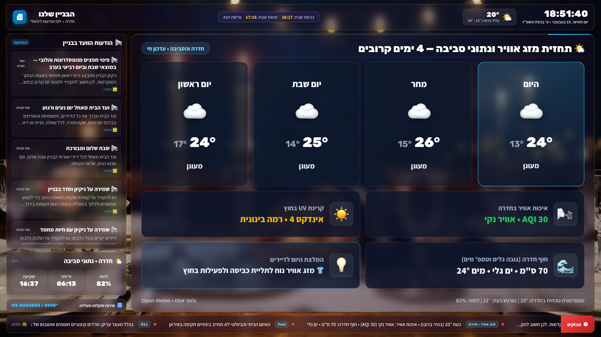
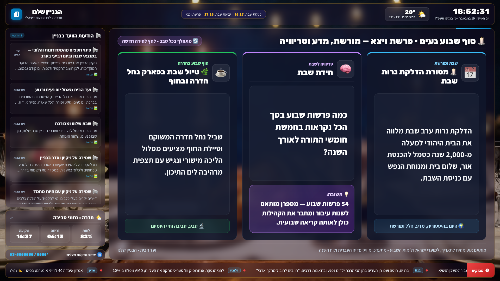
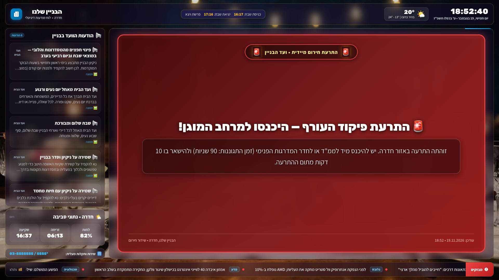
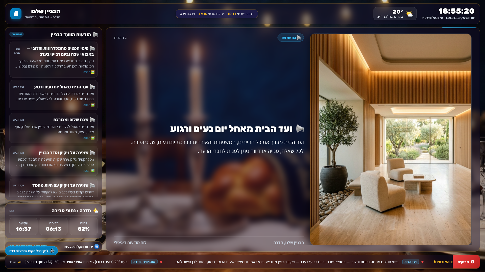
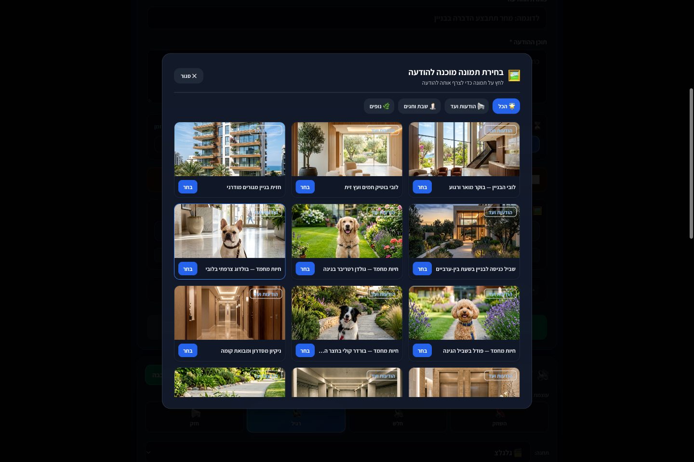
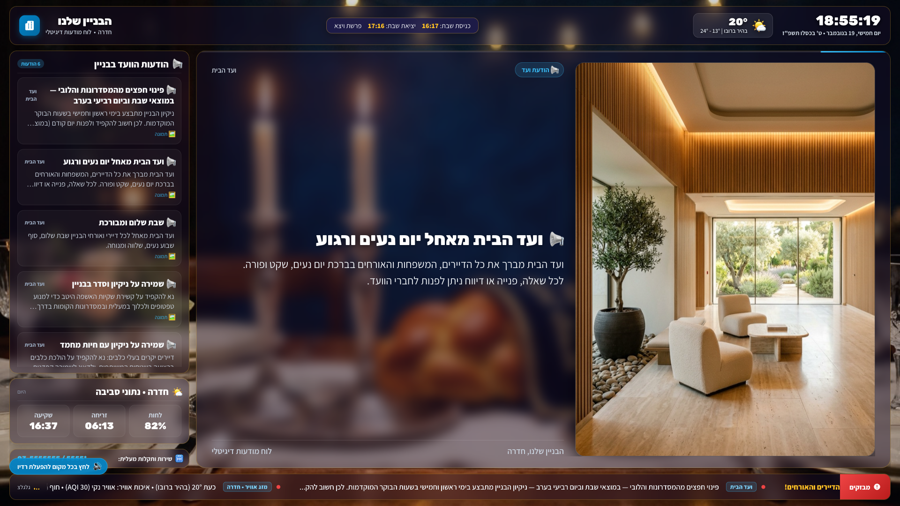
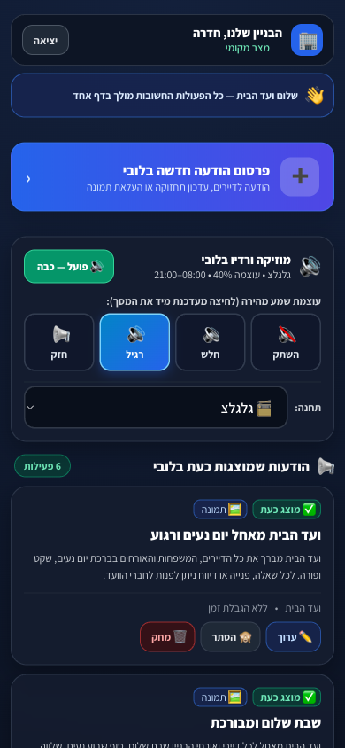
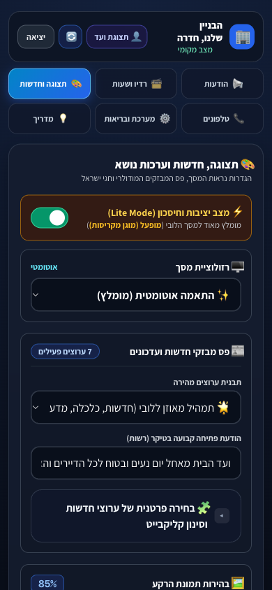
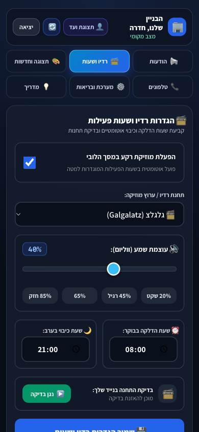
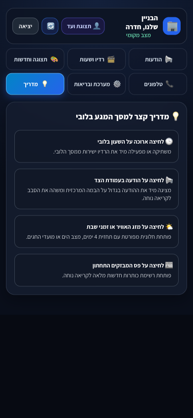

# 🏢 שילוט דיגיטלי חכם לבניין (Smart Building Digital Signage) — גרסה 2.6.0
> מערכת שילוט דיגיטלי עצמאית, אינטראקטיבית ומודרנית למסכי מגע בלובי הבניין ופאנל ניהול חכם לוועד הבית.

  <b><a href="README.md">🇬🇧 English</a></b> | 
  <b><a href="README.he.md">🇮🇱 עברית (Hebrew)</a></b> | 
  <b><a href="CHANGELOG.md">📋 יומן שינויים מלא (Changelog)</a></b>

---

## 🌐 פריסה וגישה למערכת
* 🖥️ **תצוגת לוח השילוט בלובי:** `https://<your-domain>/` (או כתובת ה-GitHub Pages הראשית)
* 📱 **ממשק ניהול לוועד (נייד ודסקטופ):** `https://<your-domain>/admin.html`
  * 🔑 **קוד מנהל ראשי ברירת מחדל:** `1234` *(ניתן לשינוי בהגדרות)*
  * 👤 **קוד חבר ועד ברירת מחדל:** `1111` *(ניתן לשינוי בהגדרות)*

---

## 🔄 מה היה קודם מול מה יש עכשיו (Before vs. After — אבולוציית המערכת ל-v2.6.0)

טבלה זו מרכזת את קפיצת המדרגה ההנדסית והמוצרית מהגרסאות הראשונות (`v1.0–v2.3`) ועד לגרסה הנוכחית (`v2.6.0`):

| תחום / תת-מערכת | ⬅️ מה היה קודם (גרסאות 1.0–2.3) | ➡️ מה יש עכשיו (גרסה 2.6.0) |
| :--- | :--- | :--- |
| **📢 ניהול מודעות, ימי ניקיון והגנת נפח** | פרסום ידני מיידי בלבד ותאריך תפוגה בסיסי; סכנת חזרת מודעות שנמחקו ("מודעות זומבי"); הצטברות תמונות Base64 ב-Firestore. | **בחירת משך זמן בלחיצה אחת (`עד מחר` / `3 ימים` / `שבוע` / `חודש`), תזמון מראש (`startsAt`), מחזוריות שבועית (`recurringDays`) ובונה ימי ניקיון קבועים (`#cleaning-schedule-panel`)** המדגיש אוטומטית פינוי חפצים בערב שלפני; הפרדה בין הודעות פעילות ל-**מגירת הודעות ישנות/מוסתרות**; וניקוי אוטומטי (`Auto-Prune`) מעל 24 שעות. |
| **📱 ממשק ניהול מותאם לאייפון ולחברי ועד** | ממשק ארוך ועמוס שדרש גלילה מרובה לפני הגעה לפרסום הודעה או שליטה במוזיקה. | **תצוגת ועד פשוטה בדף אחד (`simple-committee-mode`):** הכל במסך הראשון באייפון ללא גלילה — כפתור ראשי **`➕ פרסום הודעה חדשה`**, **כרטיס מוזיקה ו-4 כפתורי ווליום מיידיים בדף הבית**, רשימת הודעות פעילות בלבד, מגירות מתקפלות לימי ניקיון וחירום (הקופץ אוטומטית לראש המסך בחירום), **רשת לשוניות `3×2` בנייד**, מתג `👤 תצוגת ועד`, **הצפנת קודי גישה ב-`SHA-256`** וסנכרון ענן חלקי מונע-דריסות. |
| **✨ כתיבת ועיצוב מודעות (AI / Smart Composer) ומאגר תמונות מגוון** | הקלדה ידנית מאפס של כל הודעה, מאגר מצומצם של 6 תמונות נושא בלבד (כלב אחד ולובי אחד שחזרו על עצמם בכל הודעה), והעלאת תמונות גולמיות מהטלפון ללא כיווץ בצד הלקוח. | **עוזר ניסוח חכם לוועד (`#ai-polish-notice-btn`)**: מנוע ניסוח עברי מובנה ל-11 נושאים + תמיכה ב-Gemini 1.5 Flash API + **7 תבניות מילוי מהיר (`SMART_DRAFTS`)** + **כיווץ תמונות אוטומטי ב-Canvas (`720px`)** + **מאגר מורחב של 14 תמונות נושא אנכיות (`3:4`) במשקל קל (`750px`, כ-`150KB` לתמונה)** הכולל 4 תמונות כלבים שונות, 4 תמונות בניינים ולוביים, מעלית וחניון, עם **רוטציה דינמית חכמה ללא עומס זיכרון (`resolveNoticeImageUrl`)**. |
| **🚨 מצב חירום והתרעות פיקוד העורף** | לא היה מצב חירום ייעודי או חיבור להתרעות פיקוד העורף; נדרש לכתוב מודעה רגילה במקרה חירום. | **שכבה כפולה (אוטומטית + ידנית):** 1) **חיבור אוטומטי להתרעות פיקוד העורף (`startOrefAlertPoller`)** בשרת מקומי המזהה אזעקה פעילה, מציג הנחיות מרחב מוגן, משתיק מיד את הרדיו וחוזר לשגרה לאחר 10 דקות. 2) **פאנל חירום מתקפל** שנשמר סגור בשגרה וקופץ אוטומטית לראש המסך (`order: -10`) ברגע הפעלתו. |
| **🌤️ מזג אוויר, איכות אוויר וים (מותאם ל-1080p)** | תחזית טמפרטורה בסיסית ל-4 ימים בלבד ומיפוי חלקי של קודי מזג אוויר. | **תחנת סביבה, אוויר וים בקנה מידה מלא ל-1080p (Open-Meteo + כל 28 קודי ה-WMO):** מדד איכות אוויר (`AQI`), קרינת `UV`, גובה גלים וטמפ' מים בחוף, ו-**המלצה יומית דינמית לפי מצב אמת ויום בשבוע** (סערה, אחוזי גשם, אזהרת אספלט חם לבעלי כלבים, בוקר קר, או טיול חוף בסופ"ש). |
| **🚆 שקופית "יוצאים מהבניין" (תחבורה ודרכים)** | לא קיים. | **שקופית תחבורה ציבורית ודרכים מוגדלת ל-1080p (`transit_commute`):** זמני רכבת ישראל הקרובים (עם התאמה אוטומטית ל-**ימי חול, שישי, שבת, ערב חג וחג/שבתון**), קווי אוטובוס מרכזיים, וזמני נסיעה בכבישים ראשיים לפי שעות השיא. |
| **🧠 שקופית "רגע של עניין במעלית" (מועשרת הקשרית)** | מצגת שקופיות כללה רק מודעות ועד, מזג אוויר ושבת. | **מנוע תוכן חי ומתחלף (`daily_interest`):** **50+ ערכות מדע, חלל וטבע מקומי** בשילוב שליפה יומית חיה של **"היום בהיסטוריה" מוויקיפדיה העברית**, **14 מאגרים ייעודיים לחגי ישראל ושבת**, ומצב מורשת והנצחה מכובד בימי הזיכרון הממלכתיים. |
| **🕯️ לוח שנה עברי, ישראלי ובינלאומי מלא** | זמני סוף שבוע בלבד ותאריך לועזי בלבד מתחת לשעון. | **לוח ישראלי שנתי מתגלגל (`hebcal?v=1&i=on`) + שעון קיץ/חורף אוטומטי:** כל חגי ישראל, הצומות, ראשי החודשים, ספירת העומר, חג הסיגד, יום השפה העברית, יום המשפחה, המימונה, מעבר אוטומטי בין ערב יום הזיכרון ליום העצמאות, **התרעת מעבר לשעון קיץ/חורף (`Asia/Jerusalem`)**, עונות השנה ו-30+ ימים מיוחדים לאומיים ובינלאומיים. |
| **📰 פס מבזקים מודולרי (14 ערוצים) ואנטי-קליקבייט** | משיכת פיד RSS בודד כל 5 דקות דרך `rss2json` בלבד. | **בונה ערוצים מודולרי (`#modular-news-matrix`):** בחירה חופשית מתוך **14 ערוצים חיים** — חדשות (`Ynet`, `N12` ישיר, `וואלה`, `מעריב`), כלכלה (`גלובס`, `Ynet כלכלה`), מדע וטק (`הידען`, `גיקטיים`, `דיגיטל`) וערוצי בניין/מזג אוויר/לוח עברי/טריוויה, עם סינון קליקבייט מובנה. |
| **🛡️ יציבות Kiosk 24/7, הדלקת רדיו בבוקר וקופסה שחורה** | רגישות לדליפות זיכרון טבעיות ב-WebView ישן (`rk3368`) וחסימת הדלקת רדיו אוטומטית בבוקר. | **הנדסת שרידות מוכחת לחומרת `rk3368`:** ניקוי זיכרון לילי רך (`performNightSoftMaintenanceSweep`) השומר על הרשאת השמע להדלקת רדיו אוטומטית בבוקר, שחרור מלא של מפענח השמע בלילה (`preload="none"`), הגבלת רוחב טקסטורת GPU בטיקר, כתיבת JSON אטומית בשרת ו-**קופסה שחורה בענן (`device_logs` + `device_health`)**. |

---

## 📸 גלריית צילומי מסך מהמערכת (עודכן לגרסה 2.6.0)

### 🆕 1. חידושי גרסה 2.6.0 — ווידג'טים חכמים ללובי, פיקוד העורף ומאגר תמונות מועשר

| 🌤️ תחזית 4 ימים + איכות אוויר (`AQI`), קרינת `UV`, מצב הים בחוף חדרה ותאריך עברי חי | 🚆 שקופית "יוצאים מהבניין" — רכבת חדרה מערב, קווי אוטובוס וזמני נסיעה בכבישים |
| :---: | :---: |
|  |  |

| 🧠 שקופית "רגע של עניין במעלית" — הידעת, חידת טריוויה יומית וטיפ לבית | 🚨 מצב התרעת חירום / פיקוד העורף על כל המסך (הנחיות מרחב מוגן והשתקת רדיו) |
| :---: | :---: |
|  |  |

| 🐶 גיוון דינמי של תמונות כלבים בהודעות (בולדוג צרפתי בלובי / פודל / בורדר קולי) | 🏢 גיוון דינמי של תמונות בניינים ולוביים (חזית בניין מודרני / לובי בוטיק / חצר ערב) |
| :---: | :---: |
|  |  |

| 🛠️ אדמין 2.6.0: פאנל חירום, חיבור אוטומטי לפיקוד העורף, תזמון ומד חיסכון נפח | 🖼️ אדמין 2.6.0: גלריית 14 תמונות נושא מועשרת + בקרת שקופיות ותמהיל חדשות `smart_mix` |
| :---: | :---: |
|  |  |

| 🎛️ אדמין 2.6.0 (לשונית 2): מתגי שקופיות תחבורה ו"רגע של עניין" ומנוע חדשות אנטי-קליקבייט | 📞 מסך הלובי: ספר טלפונים ומספרי חירום לבניין |
| :---: | :---: |
|  |  |

---

### 🖥️ 2. תצוגות נוספות ממסך שילוט הלובי (1080p Full HD)

| 🐕 הודעת ועד: שמירה על ניקיון וחיות מחמד (גולדן רטריבר) | 🌿 הודעת ועד: ימי פינוי גזם וגרוטאות |
| :---: | :---: |
|  |  |

| 🧹 הודעת ועד: ניקיון מסדרונות ומעלית | ✨ הודעת ועד: ברכת יום רגוע בלובי |
| :---: | :---: |
|  |  |

| 🕯️ כרטיס Grand Hero: שבת שלום והדלקת נרות | 🔐 מסך הזנת קוד PIN מאובטח בנייד |
| :---: | :---: |
|  |  |

---

### 📱 3. ממשק ניהול מהנייד (Mobile Admin)

| 📢 1. לשונית ניהול הודעות מהנייד | 🎨 2. כיול תצוגה, שקיפות וערכות נושא |
| :---: | :---: |
|  |  |

| 📻 3. נגן מוזיקת רקע ורדיו 103FM | 💡 4. מפת מחוות מגע למסך הפיזי |
| :---: | :---: |
|  |  |

---

## ✨ פירוט יכולות המערכת (גרסה 2.6.0)

### 📢 1. לוח הודעות חכם, תזמון מראש ועוזר ניסוח אוטומטי
* **תזמון מראש ומחזוריות שבועית:** הגדרת תאריך ושעת התחלת פרסום (`startsAt`), תאריך ושעת תפוגה (`expiresAt`), ובחירת ימים קבועים בשבוע (`recurringDays: א'–ש'`) עבור הודעות חוזרות (כגון ימי ניקיון או הוצאת גזם).
* **עוזר ניסוח חכם לוועד (`✨ שפר ונסח אוטומטית`):** הופך טיוטה קצרה או מילות מפתח לנוסח רשמי, מנומס ורהוט בעברית עבור 11 נושאים נפוצים בבניין, מצרף תמונת נושא אוטומטית, מסמן דחיפות בעת תקלה ומחשב תאריך תפוגה מומלץ. תומך גם בחיבור אופציונלי ל-Google Gemini 1.5 Flash API.
* **7 תבניות מילוי מהיר בלחיצה אחת (`SMART_DRAFTS`):** הפסקת מים, תחזוקת מעלית, ניקיון חניון/לובי, הדברה, אסיפת דיירים, פינוי גזם וגביית דמי ועד.
* **מאגר מועשר של 14 תמונות נושא אנכיות (`3:4`) וגיוון דינמי ללא עומס (`resolveNoticeImageUrl`):** כולל 4 תמונות כלבים מגוונות (גולדן רטריבר, בולדוג צרפתי בלובי, פודל בשביל הגינה, בורדר קולי בחצר), 4 תמונות בניינים ולוביים (לובי בוקר, חזית בניין ישראלי מודרני, לובי בוטיק חם עם עץ זית, כניסת בניין מוארת בערב), מעלית חדישה, חניון תת-קרקעי, גזם, תחזוקה וקהילה. כל התמונות מכווצות מראש לרוחב `750px` (`100KB–250KB` בלבד לתמונה), ומסך הלובי מגוון אוטומטית בין תמונות הכלבים והבניינים בין הודעות וסבבים מבלי לטעון תמונות כפולות לזיכרון (`decoding="async"`).
* **כיווץ תמונות חכם וניקוי אוטומטי (`Auto-Prune`):** העלאת תמונות מהנייד עוברת דחיסת Canvas אוטומטית (`720px`), ותמונות של מודעות שפג תוקפן מעל 24 שעות מנוקות אוטומטית כדי לשמור על מסד הנתונים מהיר ומתחת למגבלת ה-1MB של Firestore.

### 🚨 2. מצב התרעת חירום וחיבור אוטומטי לפיקוד העורף
* **חיבור אוטומטי להתרעות פיקוד העורף (`startOrefAlertPoller`):** דגימה שקטה ברקע המזהה אזעקת אמת באזור הבניין, מעבירה מיד את המסך לתצוגת חירום אדומה עם הנחיות כניסה למרחב המוגן, משתיקה את הרדיו החי, ומחזירה את המסך לשגרה אוטומטית 10 דקות לאחר תום האזעקה.
* **פאנל חירום ידני מהנייד:** זמין בראש לשונית 1 באדמין (גם למנהל ראשי וגם לחבר ועד) עם 4 תבניות חירום בלחיצה אחת: **🚀 הנחיות פיקוד העורף**, **🛗 השבתת מעלית / חילוץ**, **💧 הפסקת מים דחופה**, ו-**⚡ תקלת חשמל בבניין**.

### 🌤️ 3. שקופיות תוכן חכמות ללובי (Weather, Transit & Infotainment)
* **סביבה, אוויר וים בשקופית מזג האוויר:** בנוסף לתחזית 4 ימים, מוצגים מדד איכות האוויר (`AQI`), קרינת `UV`, מצב הים (גובה גלים וטמפ' המים בחוף), והמלצה יומית חכמה לדיירים.
* **שקופית "יוצאים מהבניין — תחבורה, רכבת ודרכים" (`transit_commute`):** זמני רכבת ישראל הקרובים לשני הכיוונים (כולל התאמה לימי שישי, שבת ומוצ"ש), קווי אוטובוס מרכזיים בשכונה, וזמני נסיעה משוערים לצירי תנועה מרכזיים עם חיווי עומס לפי שעות השיא.
* **שקופית "רגע של עניין במעלית" (`daily_interest`):** תוכן מתחלף יומי הכולל עובדה היסטורית/מדעית ("היום בהיסטוריה / הידעת?"), חידת טריוויה יומית עם תשובה, וטיפ שימושי לבית ולקהילה.

### 🕯️ 4. לוח שנה עברי חי ומועדי ישראל
* **תאריך עברי מלא בכותרת:** הצגת התאריך העברי המדויק באותיות עבריות לצד התאריך הלועזי מתחת לשעון הראשי.
* **מנוע Hebcal GPS וערכות נושא לחגים:** חישוב אוטומטי של זמני הדלקת נרות, הבדלה ופרשת השבוע, תגיות מיוחדות בכותרת עבור **נרות חנוכה, ספירת העומר וראש חודש**, והחלפת רקעים אוטומטית ל-15 מועדי ישראל וימים לאומיים.

### 📰 5. מבזקי חדשות ומנוע אנטי-קליקבייט (`smart_mix`)
* **תמהיל חכם ללובי (`smart_mix`):** שילוב מאוזן של חדשות, מדע, כלכלה וטכנולוגיה (`כאן חדשות`, `גלובס`, `כלכליסט`, `הידען`, `גיקטיים`, `Ynet`, `Mako`, `Walla`).
* **סינון קליקבייט אוטומטי (`filterClickbaitAndFormatHeadline`):** הסרת כותרות סנסציוניות ("לא תאמינו", "הלם", "צפו:") ותוכן שיווקי, והוספת תגיות נושא נקיות (`[מדע]`, `[כלכלה]`, `[טכנולוגיה]`, `[חדשות]`).
* **שרידות רשת גבוהה:** רענון כל 10 דקות עם נפילה אוטומטית (Fallback) ל-`AllOrigins` XML `DOMParser` ולכותרות מערכת מובנות.

### 📻 6. נגן מוזיקת רקע ורדיו ישראלי (עם הגנת תקיעות באפר)
* **10 ערוצי רדיו ומוזיקה:** `103FM`, `גלגלצ`, `גלי צה"ל`, `כאן 88`, `כאן גימל`, `קול המוסיקה`, `Eco 99 FM`, `רדיוס 100FM`, `Chillout Lounge`, `Dance & Hits`.
* **הגנת Stall אוטומטית:** ניטור רציף של התקדמות הניגון (`currentTime`) וריענון אוטומטי של הבאפר (`recycleAudioBuffer`) במקרה של תקיעת סטרים או נפילת אינטרנט רגעית, בתוספת כיבוי אוטומטי בשבת/יום כיפור ובעת התרעת חירום.

### 🛡️ 7. שרידות חומרה 24/7, Lite Mode וקופסה שחורה (Blackbox Flight Recorder)
* **מצב חומרה קלה (`Lite Mode`) ובורר רזולוציה (`auto` / `1080p` / `720p`):** ביטול אפקטי `backdrop-filter: blur()`, אנימציות `box-shadow` וזום רקע (`Ken-Burns`) להבטחת עבודה חלקה וללא התחממות על מעבדי אנדרואיד ישנים (כגון `Rockchip rk3368` עם `Android 7.1.2`).
* **קופסה שחורה וטלמטריה בענן (`device_health` & `device_logs`):** ניטור מרחוק של זמן פעילות (Uptime), שימוש בזיכרון (JS Heap), רזולוציית מסך פעילה, ויומן אירועים וקריסות בלשונית 5 באדמין.

---

## 📱 לשוניות ממשק הניהול והרשאות גישה (Dual-PIN)

| לשונית | תיאור היכולות בלשונית | גישת מנהל ראשי (`1234`) | גישת חבר ועד (`1111`) |
| :--- | :--- | :---: | :---: |
| 📢 **1. דף הבית: הודעות, מוזיקה מהירה וחירום** | פרסום הודעה חדשה (עם בחירת משך זמן בלחיצה אחת), **כרטיס מוזיקה ו-4 כפתורי ווליום מיידיים**, הודעות פעילות מול מגירת ארכיון, ומגירות מתקפלות לימי ניקיון וחירום | ✅ *(+ מתג `👤 תצוגת ועד`)* | ✅ *(מסך בית מאוחד ונקי)* |
| 🎨 **2. תצוגה, שקופיות וחדשות** | מצב Lite Mode, בורר רזולוציה (`1080p`/`720p`), מתגי שקופיות, **בונה ערוצי חדשות מודולרי (14 ערוצים)**, שקיפות ופיצוי תאורה | ✅ | ❌ *(מוסתר)* |
| 📞 **3. טלפונים ומעלית** | עריכת מספרי טלפון לתקלות מעלית, מוקד עירוני וועד הבית | ✅ | ❌ *(מוסתר)* |
| 📻 **4. רדיו ושעות פעילות** | קביעת שעות הדלקה וכיבוי אוטומטיים (`06:30–23:00`), כוונון ווליום עדין ונגן בדיקה חי ל-10 תחנות מאומתות | ✅ | ❌ *(שליטה מהירה בדף הבית)* |
| ⚙️ **5. מערכת, בריאות ואבטחה** | פרטי הבניין, מוניטור בריאות המכשיר (`device_health`), קופסה שחורה (`device_logs`), וניהול **קודי גישה מוצפנים ב-`SHA-256`** | ✅ | ❌ *(מוסתר)* |
| 💡 **6. מדריך מגע** | מדריך מחוות מגע במסך הלובי | ✅ | ❌ *(מוסתר)* |

---

## 📦 היסטוריית גרסאות (Release History)

| גרסה | תאריך | עיקרי השינויים והחידושים |
| :--- | :---: | :--- |
| **`v2.6.0` (`v270`)** | `2026-11-19` | **מהפך ממשק ניהול לאייפון ולוועד, לוח שנה ישראלי שנתי מלא, "היום בהיסטוריה" חי מוויקיפדיה, יציבות `rk3368` והצפנת קודי גישה (`SHA-256`):** עיצוב מחדש של פאנל הניהול לנייד עבור חברי ועד (מסך בית ללא גלילה עם שליטה מהירה במוזיקה ו-4 כפתורי ווליום מיידיים, בחירת משך פרסום בלחיצה אחת, הפרדת הודעות פעילות מארכיון, רשת לשוניות `3×2` וסנכרון ענן חלקי מונע-דריסות); שדרוג ללוח ישראלי מתגלגל מלא (`hebcal?i=on`), זיהוי אוטומטי של שעון קיץ/חורף, 30+ ימים מיוחדים, שליפה יומית מוויקיפדיה העברית ל"היום בהיסטוריה" ו-14 מאגרי תוכן לחגים, שבת וימי זיכרון; הגדלת פאנלי המידע ל-`1920x1080`; מניעת קריסות חומרה ב-`rk3368` והדלקת רדיו אוטומטית בבוקר; עדכון כל 10 תחנות הרדיו והצפנת קודי ה-PIN ב-`SHA-256`. |
| **`v2.5.0`** | `2026-10-18` | **כלי ניהול חכמים באדמין (Innovations #2, #4, #5):** תזמון מודעות מראש (`startsAt`) ומחזוריות שבועית (`recurringDays`); **פאנל התרעת חירום מתפרצת** על כל המסך עם 4 תבניות בלחיצה אחת והשתקת רדיו אוטומטית; **עוזר ניסוח מודעות חכם לוועד (`✨ שפר ונסח אוטומטית`)** עם מנוע עברי מובנה ל-11 נושאים, תמיכה ב-Gemini API ו-7 תבניות מהירות; וניקוי אוטומטי (`Auto-Prune`) של תמונות ממודעות שפג תוקפן בעת טעינה ושמירה. |
| **`v2.4.6`** | `2026-10-18` | **שרידות רשת 24/7 והגנות יציבות (Deep Audit Quick Wins):** התאוששות אוטומטית מנפילות Wi-Fi וטעינת SDK דינמית ב-`firebase-sync.js`; מנויים עצלים (Lazy) ל-`device_health` ו-`device_logs`; זיהוי תקיעת באפר ברדיו חי (30 שניות) וריענון אוטומטי; דילוג על קריאות `/api/...` ב-GitHub Pages; סגירה אוטומטית של מודאלים לאחר 45 שניות; מניעת חזרת "מודעות זומבי"; הגבלת קצב שגיאות (Circuit Breaker) בקופסה השחורה; וגיבוי `AllOrigins` XML לחדשות. |
| **`v2.4.5`** | `2026-10-13` | **אופטימיזציית GPU לאנדרואיד וכיווץ תמונות:** תיקון רינדור זמני שבת בכותרת (`applySettings`); כיווץ תמונות אוטומטי ב-HTML5 Canvas (`compressImageToDataUrl`) בהעלאה מהנייד; איחוד `toggleSecretMute`; הקלות GPU ומניעת דליפות זיכרון ב-`Lite Mode` למעבדי `rk3368` (ביטול Ken-Burns ואנימציות `box-shadow`, קיצור ריענון באפר אודיו ל-30 דקות). |
| **`v2.4.3–2.4.4`** | `2026-09-28` | **קופסה שחורה ובורר רזולוציית מסך:** הוספת Blackbox Flight Recorder (`smart_lobby/device_logs`) למעקב אחר אתחולים ושגיאות זמן ריצה מרחוק; הוספת בורר רזולוציית מסך והתאמת גופנים (`auto` / `1080p` / `720p`) וניטור רזולוציה חי ב-`device_health`. |
| **`v2.4.0–2.4.2`** | `2026-09-16` | **מפרט עיצוב דו-שכבתי ודיוק לוח שידורים:** הוספת מוניטור בריאות מכשיר (`device_health`), דיוק כיבוי רדיו ב-23:00 וריענון זיכרון לילי ב-23:05/04:00, תמיכה ב-N12 (Mako), וסינון מודעות שפג תוקפן. |
| **`v2.1.0–2.3.0`** | `2026-09-04` | **סנכרון ענן Firebase, הרשאות Dual-PIN ו-Lite Mode:** חיבור ל-Google Cloud Firestore בזמן אמת, הפרדת הרשאות בין מנהל ראשי לחבר ועד, חבילת תמונות חגים מובנית, והוספת מצב `Lite Mode` למכשירי אנדרואיד. |

*(לפירוט טכני מלא של כל שינוי וקובץ ראו [`CHANGELOG.md`](CHANGELOG.md)).*

---

## 📺 המלצות לאפליקציות Kiosk ונעילת מסך באנדרואיד

עבור התקנה קבועה בלובי (טאבלטים או מסכי מגע צמודי קיר 24/7), אנו ממליצים על שתי אפליקציות מצטיינות:

### 🥇 1. [Webview Kiosk](https://webviewkiosk.nktnet.uk) (המלצה ראשית - 100% חינמי וקוד פתוח)
* 🆓 **100% קוד פתוח וחינמי (FOSS):** ללא הגבלות, ללא סימני מים וללא צורך ברישיונות בתשלום.
* 📱 **מותאם במיוחד למכשירים ישנים:** עובד חלק ומהיר על טאבלטים וממירים ישנים (כגון Android 7.1.2) עם צריכת זיכרון מינימלית (מומלץ להפעיל **Lite Mode** בהגדרות התצוגה).
* 🔒 **נעילת משימות (Lock Task Mode):** נעילת המסך לאפליקציה בודדת, הסתרת שורת הסטטוס ומניעת יציאה.
* 📦 **התקנה פשוטה:** זמין ב-[Google Play](https://play.google.com/store/apps/details?id=uk.nktnet.webviewkiosk), ב-[F-Droid](https://f-droid.org/) ובהורדת APK ישירה מ-[GitHub](https://github.com/nktnet1/webview-kiosk).

### 🥈 2. [Fully Kiosk Browser](https://www.fully-kiosk.com/) (התקן המסחרי המתקדם)
* ⚡ **עבודה חלקה ב-60fps** עם הפעלה אוטומטית (Auto-Start) לאחר הפסקת חשמל.
* 🔒 **נעילת Kiosk מלאה** המונעת מעוברי אורח לצאת מהאפליקציה.
* 💡 **זיהוי תנועה במצלמה (Motion Detection):** הדלקת המסך כשמישהו ניגש למעלית/לובי.

---

## 🌍 איך להקים מסך כזה לבניין שלכם ב-3 דקות (מדריך שימוש בתבנית)

כל אחד מוזמן להשתמש בפרויקט ולהרים מסך שילוט חכם לבניין שלו:

1. **לחצו על כפתור `Use this template`** בראש המאגר ב-GitHub.
2. **התאימו את פרטי הבניין** בקובץ `data/settings.json` (שם הבניין, עיר וקואורדינטות GPS לזמני שבת ומזג אוויר מדויקים).
3. **הפעילו את GitHub Pages:**
   * היכנסו ל-**Settings ➡️ Pages** במאגר שלכם.
   * בחרו ב-**GitHub Actions** (או **Deploy from a branch `main`**).
   * **לוח השילוט של הבניין שלכם באוויר ופעיל מיד!**
4. *(אופציונלי אך מומלץ)* **הפעלת סנכרון ענן בזמן אמת (Firebase Firestore):**
   * פתחו פרויקט חינמי ב-[Firebase Console](https://console.firebase.google.com).
   * בתפריט בחרו **Build** ⬅️ **Firestore Database** ⬅️ לחצו **Create database**.
   * בלשונית **Rules (כללים)**, הדביקו את תוכן הקובץ [`firestore.rules`](firestore.rules) ולחצו **Publish**.
   * העתיקו את `js/config.example.js` לקובץ `js/config.js` והדביקו את מפתחות ה-Firebase שלכם.

---

## 📜 רישיון וקרדיט

כל הזכויות שמורות (c) 2026 **עומר ניניו (Omer Ninyo)**.  
פרויקט זה מופץ תחת תנאי רישיון **MIT עם ייחוס חובה (Attribution)**. כולם מוזמנים לעיין, להשתמש, לשכפל ולהתאים את הפרויקט לבניין שלהם, ובלבד שנשמר קרדיט מפורש ליוצר הפרויקט **Omer Ninyo**.
