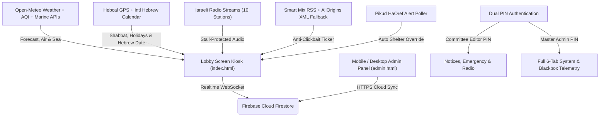

  <b><a href="README.md">🇬🇧 English</a></b> | 
  <b><a href="README.he.md">🇮🇱 עברית (Hebrew)</a></b> | 
  <b><a href="CHANGELOG.md">📋 Full Changelog</a></b>

# 🏢 Smart Building Digital Signage (לוח שילוט דיגיטלי חכם לבניין) — v2.6.0
> A modern, autonomous, touchscreen-enabled Digital Signage Kiosk & Smart Building Management Platform for residential lobbies and building committees (ועד בית).

---

## 🌐 Quick Access & Deployment
* 🖥️ **Lobby Kiosk Display:** `https://<your-domain>/` (or your GitHub Pages root)
* 📱 **Mobile & Desktop Admin Panel:** `https://<your-domain>/admin.html`
  * 🔑 **Default Master Admin PIN:** `1234` *(Customizable in settings)*
  * 👤 **Default Committee Member PIN:** `1111` *(Customizable in settings)*

---

## 🔄 Before vs. After — System Evolution to v2.6.0

The table below summarizes the architectural and product evolution from the initial releases (`v1.0–v2.3`) to the current `v2.6.0` release:

| Subsystem | ⬅️ Before (`v1.0–v2.3`) | ➡️ Now (`v2.6.0`) |
| :--- | :--- | :--- |
| **📢 Notice Scheduling & Storage Hygiene** | Immediate manual publishing only with basic expiration; risk of deleted default notices reappearing ("zombie notices"); unbounded Base64 image accumulation in Firestore. | **Future Start Scheduling (`startsAt`) & Weekly Recurring Days (`recurringDays: [0..6]`)** with live 60s transitions; persistent deletion registry (`smart_lobby_deleted_notices`); **Automated Base64 Image Pruning (`Auto-Prune`)** for notices expired >24h with live storage-savings badges. |
| **✨ Smart Notice Authoring (AI & Heuristic Composer)** | Manual text entry from scratch; raw multi-megabyte mobile photo uploads on static hosting. | **Smart Committee Notice Assistant (`#ai-polish-notice-btn`)**: built-in zero-key Hebrew heuristic composer across 11 building topics + optional Google Gemini 1.5 Flash API integration + **7 1-Click Quick Templates (`SMART_DRAFTS`)** + **Client-Side HTML5 Canvas Image Compression (`720px`, quality `0.78`)**. |
| **🚨 Emergency Mode & Home Front Command (Pikud HaOref)** | No emergency override or automated civil defense integration. | **Dual-Layer Emergency System:** 1) **Automated Pikud HaOref Poller (`startOrefAlertPoller`)** detecting active local alerts, displaying high-contrast shelter instructions (90s), muting live radio immediately, and auto-restoring routine after 10 minutes. 2) **1-Click Admin Emergency Broadcast Panel** (`oref`, `elevator`, `water`, `power`) accessible to both Master Admin and Committee Editor. |
| **🌤️ Weather, Air Quality & Marine Station** | Basic 4-day temperature forecast only. | **Full Environmental & Marine Dashboard (Open-Meteo Air Quality & Marine APIs, zero key):** European Air Quality Index (`AQI`) with color badges, `UV` radiation index, coastal wave height & sea surface temperature, and an **Automated Smart Daily Resident Tip (`dailyTip`)** (laundry, windows/haze, heat hydration) on both the main stage slide and touch modal. |
| **🚆 "Leaving the Building" Transit & Commute Slide** | Not available. | **Live Transit & Commute Slide (`transit_commute`):** Dynamic Israel Railways departures (South/Tel Aviv & North/Haifa with Shabbat/Motzaei Shabbat awareness), local & intercity bus lines, and estimated drive times on major highways (Road 2, Road 4, Road 9) with peak-hour congestion color badges. |
| **🧠 "Elevator Moment of Interest" Infotainment Slide** | Slideshow rotated only building notices, weather, and Shabbat cards. | **Captivate-Style Daily Infotainment Slide (`daily_interest`):** 20 curated daily Hebrew sets rotating automatically by day of year (`dayOfYear % 20`), featuring: **📅 This Day in History / Did You Know?**, **🧠 Daily Resident Trivia (with answer box)**, and **💡 Practical Home & Community Tip**. |
| **🕯️ Live Hebrew Calendar & Tradition** | Basic candle-lighting and holiday cards; Gregorian-only date under the clock; `holidays[0]` selection could mask major holidays behind minor entries. | **Live Hebrew Date in Header:** Full Hebrew date in traditional Hebrew letters under the digital clock (`יום רביעי, 21 באוקטובר • י' בחשוון תשפ"ז`), priority sorting for major holidays, and automatic header/modal badges for **🕯️ Hanukkah Candles, 🌾 Sefirat HaOmer, and 🌙 Rosh Chodesh**. |
| **📰 News Ticker & Anti-Clickbait Engine** | Single RSS feed polled every 5 minutes via `rss2json` only (vulnerable to HTTP 429 quota limits and clickbait/sponsored headlines). | **Smart Mix (`smart_mix`) Anti-Clickbait Engine:** Automated clickbait & sponsored-content filter (`filterClickbaitAndFormatHeadline`), multi-source interleaved feeds across News, Science (`Hayadan`), Tech (`Geektime`), and Economy (`Globes`, `Calcalist`, `Kan`) with clean category tags (`[מדע]`, `[כלכלה]`, `[טכנולוגיה]`), 10-minute polling (50% quota reduction), and automatic `AllOrigins` XML `DOMParser` fallback. |
| **🛡️ 24/7 Kiosk Hardware Stability, Audio Recovery & Blackbox** | Vulnerable to boot-time Wi-Fi drops, live radio stream buffer stalls, GPU overload on legacy Android SoCs (`rk3368`), and silent crashes. | **24/7 Mission-Critical Engineering:** Automatic Wi-Fi reconnect (`online` listener + dynamic Firebase SDK loader), 30s live radio stall detection & buffer recycling (`recycleAudioBuffer`), GPU-safe **Lite Mode** & **Resolution Selector (`auto`/`1080p`/`720p`)**, 45s modal auto-close watchdog, and a cloud-synced **Blackbox Flight Recorder (`device_logs` & `device_health`)** with rate-limiting circuit breaker and lazy subscriptions. |

---

## 📸 Comprehensive Visual Showcase

### 🖥️ 1. Main Lobby Touchscreen Kiosk Display (1080p Interactive Stage)

| 🐕 Notice: Pets & Lawn Care (Vertical 3:4 Layout) | 🌿 Notice: Pruning & Waste Schedule |
| :---: | :---: |
|  |  |

| 🧹 Notice: Corridor & Elevator Care | ✨ Notice: Daily Welcome & Building Greeting |
| :---: | :---: |
|  |  |

| 🕯️ Grand Hero Slide: Shabbat & Candle Lighting | 📞 Building Service & Emergency Contacts Directory |
| :---: | :---: |
|  |  |

---

### 📱 2. Mobile & Tablet Committee Administration Panel (iOS / Android)

| 🔐 1. Dual-PIN Access Keypad | 📢 2. Notice Management Tab |
| :---: | :---: |
|  |  |

| 🎨 3. Display & Opacity Calibration | 📻 4. Background Radio & 103FM Player |
| :---: | :---: |
|  |  |

| 💡 5. Touch Gestures & Hardware Map | 🖼️ 6. Curated AI Image Gallery Picker |
| :---: | :---: |
|  |  |

---

## ✨ Key Features & Capabilities (v2.6.0)

### 📢 1. Smart Notice Board, Scheduling & AI/Heuristic Notice Assistant
* **Scheduled & Weekly Recurring Notices:** Configure future publication timestamps (`startsAt`), expiration timestamps (`expiresAt`), and weekly recurring days (`recurringDays: Sun–Sat`) evaluated live every 60 seconds without page reloads.
* **Smart Committee Notice Assistant (`✨ שפר ונסח אוטומטית`):** Converts rough notes or keywords into polite, well-structured Hebrew building announcements across 11 topics, auto-attaches a matching curated image, flags urgency for utility/elevator outages, and sets smart expiration dates. Works 100% offline via its built-in Hebrew heuristic composer, with optional Google Gemini 1.5 Flash API support.
* **7 1-Click Quick Templates (`SMART_DRAFTS`):** Instant presets for water shutoffs, elevator maintenance, parking cleaning, pest control, tenant meetings, pruning schedule, and committee dues.
* **Client-Side Image Compression & Auto-Pruning:** Mobile uploads are compressed via HTML5 Canvas (`720px`), and heavy Base64 images on notices expired for >24 hours are automatically pruned (`pruneExpiredNoticeImages`) to keep Firestore documents lean.

### 🚨 2. Full-Screen Emergency Mode & Automated Pikud HaOref Integration
* **Automated Home Front Command Polling (`startOrefAlertPoller`):** Silently monitors active Pikud HaOref alerts for the building's city every 15 seconds. Upon alert detection, immediately overrides the stage with high-contrast shelter instructions, silences background radio (`stopRadioImmediate()`), and automatically restores routine operation 10 minutes after the alert ends.
* **1-Click Admin Emergency Panel:** Accessible at the top of Tab 1 to both Master Admin and Committee Editors with 4 instant presets (`oref`, `elevator`, `water`, `power`).

### 🌤️ 3. Smart Lobby Content Slides (Weather, Transit & Infotainment)
* **Environmental, Air Quality & Marine Forecast:** Combines 4-day Open-Meteo forecasts with European `AQI`, `UV` index, coastal wave height & water temperature, and an automated smart resident tip (`dailyTip`).
* **Transit, Train & Highway Commute (`transit_commute`):** Displays upcoming Israel Railways departures (South/Tel Aviv & North/Haifa with Shabbat awareness), key neighborhood bus lines, and live peak-hour drive-time estimations for major highways.
* **Daily Interest & Trivia (`daily_interest`):** Captivate-style infotainment slide rotating 20 daily Hebrew sets ("This Day in History / Did You Know?", resident trivia puzzle with answer, and home/community tip).

### 🕯️ 4. Live Hebrew Calendar & Automated Holiday Suite
* **Live Hebrew Date Header:** Renders the exact Hebrew calendar date in traditional Hebrew letters beneath the clock alongside the Gregorian date.
* **Dynamic Hebcal GPS Engine:** Calculates candle lighting, Havdalah, Parashat HaShavua, contextual badges for **Hanukkah Candles, Sefirat HaOmer, and Rosh Chodesh**, and activates curated photographic wallpapers for 15 Jewish holidays and national dates.

### 📰 5. Smart Mix News Ticker & Anti-Clickbait Engine
* **Curated Multi-Source Feeds:** Choose between **`smart_mix`** (interleaved News, Science, Tech & Economy), **`science_tech`** (`Hayadan` / `Geektime`), **`economy`** (`Globes` / `Calcalist`), **`kan_globes`**, or individual broadcasters (`Ynet`, `Kan`, `Mako`, `Walla`).
* **Anti-Clickbait Filter (`filterClickbaitAndFormatHeadline`):** Strips sensationalist clickbait phrases and sponsored posts while adding clean subject badges (`[מדע]`, `[כלכלה]`, `[טכנולוגיה]`, `[חדשות]`), backed by a 10-minute polling interval and `AllOrigins` XML `DOMParser` fallback.

### 🛡️ 6. 24/7 Hardware Resilience, Lite Mode & Blackbox Flight Recorder
* **Lite Mode & Resolution Scaling (`auto` / `1080p` / `720p`):** Bypasses GPU-intensive `backdrop-filter: blur()`, `box-shadow` pulses, and Ken-Burns transforms for rock-solid stability on low-spec Android 7+ WebView kiosks (`Rockchip rk3368`).
* **Blackbox Flight Recorder (`device_logs` & `device_health`):** Streams live uptime, JS heap usage, active viewport resolution, and crash/reload diagnostics to Tab 5 in Admin, protected by a session rate-limiting circuit breaker.

---

## 🏗️ Architecture & Technology Stack

---

## 📱 Admin Panel Tabs & Access Levels

| Tab | Description | Master Admin (`1234`) | Committee Editor (`1111`) |
| :--- | :--- | :---: | :---: |
| 📢 **1. Notices & Emergency** | Emergency Alert Panel + Auto-Oref toggle, scheduled/recurring notices, Smart AI/Heuristic Composer, image gallery | ✅ | ✅ |
| 🎨 **2. Display, Slides & News** | Lite Mode, Resolution Selector (`1080p`/`720p`), Transit & Daily Interest slide toggles, `smart_mix` news selector, opacity & burn-in compensation | ✅ | ❌ *(Hidden)* |
| 📞 **3. Contacts & Emergency** | Building service numbers (elevator, municipality, water, electricity, committee) | ✅ | ❌ *(Hidden)* |
| 📻 **4. Music & Radio** | Station selector, daily broadcast schedule, volume control, live test player | ✅ | ✅ |
| ⚙️ **5. Settings, Health & Blackbox** | Building GPS settings, live Device Health monitor (`device_health`), Blackbox Flight Recorder (`device_logs`), PIN management | ✅ | ❌ *(Hidden)* |
| 💡 **6. Help & Touch Map** | Interactive touch gestures guide and hardware interaction map | ✅ | ❌ *(Hidden)* |

---

## 📦 Release History

| Version | Date | Highlights |
| :--- | :---: | :--- |
| **`v2.6.0`** | `2026-10-21` | **Smart Lobby Widgets, Auto Pikud HaOref & Anti-Clickbait News Engine:** Added Open-Meteo Air Quality (`AQI`), `UV`, Marine wave/water temp & smart `dailyTip` to weather slide; added **Transit & Commute slide (`transit_commute`)**; added **Daily Interest & Trivia slide (`daily_interest`)** with 20 daily Hebrew sets; added **Live Hebrew Calendar Header** & Hanukkah/Omer/Rosh Chodesh badges; added **Automatic Pikud HaOref Alert Poller (`startOrefAlertPoller`)**; added **Smart Mix (`smart_mix`) Anti-Clickbait RSS Engine**. |
| **`v2.5.0`** | `2026-10-18` | **Smart Admin Innovations (#2, #4, #5):** Added notice start scheduling (`startsAt`) & weekly recurring days (`recurringDays`); added **Full-Screen Emergency Alert Mode** with 1-click presets and automatic radio mute; added **Smart Committee Notice Assistant (`✨ שפר ונסח אוטומטית`)** with 11-topic offline Hebrew composer, optional Gemini API support, and 7 quick drafts; added automatic Base64 image pruning (`Auto-Prune`) on load and save. |
| **`v2.4.6`** | `2026-10-18` | **24/7 Network & Kiosk Resilience (Deep Audit Quick Wins):** Automatic Wi-Fi reconnect & dynamic Firebase SDK recovery; lazy subscriptions for `device_health` and `device_logs`; 30s live radio stall detection & buffer recycling; static hosting `/api/...` bypass; 45s modal auto-close watchdog; zombie notice prevention; Flight Recorder circuit breaker; 10-minute RSS polling with `AllOrigins` XML fallback. |
| **`v2.4.5`** | `2026-10-13` | **Android GPU Optimization & Client Image Compression:** Fixed Shabbat header rendering (`applySettings`); added client-side HTML5 Canvas image compression (`compressImageToDataUrl`); unified `toggleSecretMute`; optimized `Lite Mode` for `rk3368` Android WebView (disabled Ken-Burns & `box-shadow` pulses, 30-min audio buffer recycle). |
| **`v2.4.3–2.4.4`** | `2026-09-28` | **Blackbox Flight Recorder & Screen Resolution Selector:** Added cloud crash/event diagnostics (`smart_lobby/device_logs`) and real-time screen resolution scaling (`auto` / `1080p` / `720p`) with live viewport reporting in `device_health`. |
| **`v2.4.0–2.4.2`** | `2026-09-16` | **Two-Tier Design Spec & Schedule Precision:** Added `device_health` telemetry, exact 23:00 radio cutoff and 23:05/04:00 memory watchdog reloads, N12 (Mako) RSS support, and notice expiration filtering. |
| **`v2.1.0–2.3.0`** | `2026-09-04` | **Firebase Cloud Sync, Dual-PIN Security & Lite Mode:** Real-time Firestore synchronization, role-based PIN access, 15 Jewish holiday photographic themes, and hardware Lite Mode. |

*(See [`CHANGELOG.md`](CHANGELOG.md) for the complete technical changelog).*

---

## 🌍 How to Deploy for Your Own Building (3-Minute Open Source Guide)
1. **Fork or click `Use this template`** on this repository.
2. **Customize your building settings** in `data/settings.json` (Building name, city, and GPS coordinates).
3. **Enable GitHub Pages** under **Settings ➡️ Pages** (via GitHub Actions or `main` branch).
4. *(Optional)* **Enable Real-Time Cloud Sync (Firebase Firestore):**
   * Create a free project at [Firebase Console](https://console.firebase.google.com), provision **Firestore Database**, and publish the rules from [`firestore.rules`](firestore.rules).
   * Copy `js/config.example.js` to `js/config.js` and paste your Firebase Web app credentials.

---

## 📜 License & Attribution

Copyright (c) 2026 **Omer Ninyo**.  
This project is licensed under the terms of the MIT License with mandatory attribution. Anyone is welcome to inspect, fork, and adapt this project for their own building, provided that **explicit credit to Omer Ninyo** is retained.
